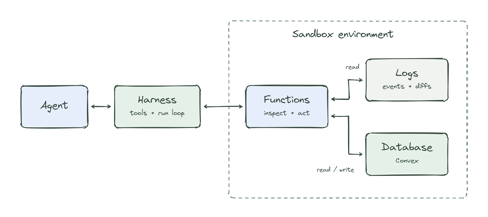

# Autonomous Finance

Autonomous Finance carries an accounts payable case from original supplier documents through field review, bill approval, payment authorization and reconciled accounting. Agents prepare the work; humans make the required business decisions. A separate restaurant-chain simulator, modeled on Sweetgreen, exercises AP, cash, revenue, payroll, leases and month-end close.

Built at Cal Hacks 13.0.

Current AP delivery: the synthetic USD Auth0 → Increase sandbox → QuickBooks flow and local bank reconciliation have passed. See [current status](docs/ap-orchestration/CURRENT-STATUS.md) and the [issue #97 scope gaps](docs/ap-orchestration/ISSUE-97-GAP-MAP.md) for remaining agent integration and review work.

## Why

Most finance agents today are a model driving a spreadsheet or a browser. Those tools were built for people. For an agent they're slow (in our test, one bookkeeping step took about six spreadsheet tool calls instead of one), and they check nothing. A spreadsheet will let you approve your own payment or pay the same invoice twice.

So we built the ledger for the agents. The agents work through it, and it enforces the finance controls itself.

## How it works



[Edit diagram](docs/images/agent-environment.excalidraw)

- **The ledger (`convex/`).** A Convex database. Every change to the books is one transaction, in integer cents, with double entry, an idempotency key and a hash chain. Each agent has its own login and limits, and the database checks them on every write. For example, a cash entry needs a matching bank transaction, and whoever requests a payment can't approve it. These rules live in the database, not in prompts.
- **Memory (`src/memory/`).** Company knowledge, like vendors, bank details, policies and every decision, is YAML in a git repo. Each change is a commit by the agent that made it. A change to bank details goes on a branch that a different agent or a human has to merge.
- **The agents (`src/agents/`).** Twelve of them: AP clerk, controller, payments, treasury and others. Routine work is plain code. The model only reads documents the code can't parse and makes judgment calls. In the historical 14-day simulator run, 92% of tasks never called the model. That is not a cost or automation-rate measurement of the document-based AP workspace.

The company is simulated. It's calibrated to Sweetgreen's FY2025 SEC filings: $679.5M revenue, 281 restaurants, $19.9M accounts payable, $354.5M lease liability. We're not affiliated with Sweetgreen, and every transaction, vendor and person in it is made up.

## Quick start

You need Node 24.18 or later, Python 3.11 or later, and git. You don't need a Convex account. The free path doesn't need an API key.

```bash
git clone https://github.com/srivatsav-kannan/autonomous-finance && cd autonomous-finance && npm ci
npm run setup               # checks your tools, writes .env.local, prepares benchmark data. Safe to rerun.
npm run backend             # terminal 1: local Convex backend. Leave it running.
npm run backend:configure   # terminal 2, once the backend is up
npm run scenario            # plays 14 days for 3 stores, scores the run, prints a briefing
npm run console             # open http://127.0.0.1:5173/?view=inbox#scenario-1
```

To approve things in the console, also run `npm run gateway` in another terminal. That process acts as the human CFO.

To turn on the model, add `OPENAI_API_KEY=...` to `.env.local`. Without it, the agents still run, but 21 of the 64 invoices come in formats only the model can read. Those invoices stay unread, so the books and the close stay incomplete.

## Run the evals

```bash
npm run evals                               # free: control tests, the simulated company with no model, the spreadsheet comparison, the public benchmarks with no model
npm run evals -- --paid --budget-usd 15     # adds the model runs. Needs OPENAI_API_KEY. Prints an estimate per run first.
```

## Ask about a run

```bash
npm run ask -- "Why was INV-1002 held?"
```

The answer cites the git commits where the decision was recorded. This works without the gateway or the console.

## What you'll see

- **`npm run scenario`** plays 14 simulated days for 3 stores: 230 events, 64 vendor invoices, 13 planted errors and 3 legitimate look-alikes. It scores the run against an answer key the agents never see. Then it prints what happened, which errors were caught, what's waiting for the CFO, and why the close is blocked.
- **The console:**
  - **Inbox:** only the decisions the CFO has to make, each with the evidence and what each answer will do.
  - **Bank & cash, Finance flow:** cash balances, the bank feed, and how work moves from documents through the agents into the books.
  - **Team, Live activity, Ledger, Memory:** the agents, everything they do as it happens, every journal entry with where it came from, and the memory commits.
  - **Evals:** the score for the run.
  - **Control room:** send in a fraudulent bank-change email, a duplicate invoice or an unknown wire, then ask the agents why they did what they did.
  - **Invoices:** a separate workspace for customer invoices ([guide](docs/invoice-mvp/README.md)).
  - **`/ap-system`:** the source-backed AP case workspace: original invoice, PO and receipt; reviewable fields; separate field, bill and payment decisions; accounting and bank evidence. See the [demo](docs/DEMO.md) and [Auth0 sandbox setup](docs/ap-orchestration/AUTH0-SETUP.md).
  - **`/ap-demo`:** the CFO's approval screen for the payment crash demo.

## The AP system and its sandboxes

An invoice states what a supplier claims. In `/ap-system`, source-backed fields remain reviewable against the original documents, with uncertain locations left visible. The PO, receipt and approved supplier context support the business decision. Reviewing fields does not approve a bill; approving a bill records the obligation; authorizing a payment approves an exact amount and destination. A quantity or price discrepancy stays held until an authorized decision: **no automatic short-pay**. These are separate actions, but independent-person enforcement is incomplete; see the control gaps below.

The internal ledger records recognition and settlement. The QuickBooks connector exports an approved Bill and records the settled payment as a linked BillPayment. Increase is the bank API that executes the payment; the QuickBooks accounting record does not send money again. Settlement reduces AP and cash without expensing the purchase twice.

QuickBooks and Increase sandboxes are real provider APIs with test books and simulated money. Automated tests use FakeBank and mocked QuickBooks responses. External sandbox checks verify the actual service contracts separately. One synthetic **$678.60** case completed on the dedicated Auth0 runtime: QuickBooks Bill **145**, BillPayment **146**, one Increase transfer and matching debit, and local bank reconciliation. Read-only provider checks confirmed the records again on Oct 25. They also exposed a missing-`APAccountRef` compatibility issue on merged main; the narrow repair here passes the same external readback. This is not a fresh end-to-end run on this branch. Signed webhook delivery, external returns/credits and formal period close remain unverified. [Acceptance report and evidence](submission/SANDBOX-ACCEPTANCE.md).

## Results

See [docs/RESULTS.md](docs/RESULTS.md) for historical raw outputs and the reported current acceptance:
- **Current reported simulator result after #105, seed 7, model on:** 13 of 13 planted errors caught, 0 false alarms; **books check fails/incomplete** because INV-1002 (short shipment) and INV-1004 (price over contract) await a human. The unattended run supplies no CFO answer.
- **Historical simulator result before #105, 4 seeds:** 13/13 errors caught and books matched every account, at $0.04–0.05 and 71–82 seconds per run. These historical results do not establish current books correctness or AP-workspace cost.
- **Same model, our ledger's tools vs spreadsheet tools, 11 tasks:** 12 vs 71 tool calls, 45 vs 94 seconds, $0.12 vs $0.48.
- **15 public benchmark tasks:** our agents scored 93.3% (14 of 15) and the same model alone scored 84.0% (12 of 15), at about 1.7× the cost.
- **Kernel controls:** 22 of 22 tests pass in the reported merged-main acceptance. This is not complete AP control coverage.

The [independent Claude model review](submission/review-105/REVIEW.md) found sound arithmetic in its probes and **three open high-severity control gaps**: a bill or supplier-bank approver can release the payment without payment amount bands; first-wave mode permits one human to review, approve, pay and post an unlinked credit; and a disputed remainder cannot later become payable on its original invoice. Medium findings remain too. Separate decision buttons and balanced journals do not establish independent approval or production readiness. This is not human accountant sign-off.

## Prerequisites

| Tool | Needed for | Notes |
|---|---|---|
| Node 24.18 or later | everything | CI uses 24.18.0. The bank simulator uses `node:sqlite`. |
| git | company memory | Each run's memory is a git repo under `var/memory/`. |
| Python 3.11 or later | `npm run setup`, `npm run evals`, `npm run bench:*` | Setup creates `var/benchmarks/.venv` and installs openpyxl, pypdf and python-docx. Set `EXTERNAL_BENCH_PYTHON` to use another interpreter, or run `npm run setup -- --skip-bench` to skip this. |
| `uv` and Python 3.12 | only the model-only harnesses in `evals/external/` and `evals/invoice-mvp/` | Not needed for the quick start. See each harness's README. |
| Playwright Chromium | `npm run test:browser:local` | `npx playwright install --with-deps chromium` |
| Chrome or Chromium | `npm run design:review` | Set `CHROME_PATH` if it's not in a standard place. |

API keys go in `.env.local`, which git ignores. With `OPENAI_API_KEY`, agents use OpenAI `gpt-6.1-sol`. Without it, they use Claude if `ANTHROPIC_API_KEY` is set. Either way, spending is capped by `AGENT_MAX_USD` (default $15, tracked in `var/agent-spend.json`). A request that could push past the cap is refused before it's sent. `AGENT_LLM=off` turns the model off everywhere.

## Repo map

| Folder | What's in it |
|---|---|
| `convex/` | The ledger and its rules: journal, bills, payments, tasks, agent logins, CFO questions, invoice cases |
| `src/agents/` | The agents and the runtime that schedules them |
| `src/memory/` | Git memory |
| `src/world/` | The simulator and the answer key |
| `src/evals/` | Scoring and the benchmark adapters |
| `src/payments/` | The payment worker and the bank evidence worker |
| `src/integrations/` | Invoice parsers, the bank simulator, the Increase adapter |
| `src/human/` | The CFO gateway and "ask why" |
| `src/ap-system/` | Source-backed supplier AP cases, review workflow, Auth0 gateway and QuickBooks accounting sync |
| `src/invoice-mvp/` | The customer invoice workspace |
| `console/` | The web console (Vite, React, Convex live queries) |
| `scripts/` | What the npm commands run |
| `tests/` | Vitest suites |
| `evals/` | Harnesses that run public benchmarks with the model alone |
| `benchmarks/` | Pinned benchmark manifests and the model budget policy |
| `company/` | The Sweetgreen calibration numbers |
| `docs/` | Results, demo plan, architecture, audit and guides |
| `submission/` | Our Devpost text and pitch script |
| `.agents/` | A design-lint skill used by `npm run design:check` ([design.md](design.md)) |

## Docs

| Doc | What's in it |
|---|---|
| [docs/RESULTS.md](docs/RESULTS.md) | Current acceptance and historical measurements, with evidence links |
| [submission/SANDBOX-ACCEPTANCE.md](submission/SANDBOX-ACCEPTANCE.md) | Actual QuickBooks/Increase results, runtime provenance and unverified checks |
| [docs/DEMO.md](docs/DEMO.md) | Demo runbook, scenario menu and Q&A prep |
| [docs/ARCHITECTURE.md](docs/ARCHITECTURE.md) | How each part is built |
| [docs/AUDIT.md](docs/AUDIT.md) | Known bugs and gaps, by severity |
| [docs/ap-demo/](docs/ap-demo/README.md) | Payments: approval, sending, bank evidence, crash recovery |
| [docs/evals/](docs/evals/README.md) | Benchmark setup, the books and close checks, raw run data |
| [docs/invoice-mvp/](docs/invoice-mvp/README.md) | The invoice workspace |
| [docs/ci.md](docs/ci.md) | What CI runs |
| [design.md](design.md) | The console's design rules |

## Command reference

### Setup

**`npm run setup`** is safe to run more than once. It:
- checks for Node, Python and git
- creates `.env.local` from `.env.example`, or adds only the settings it's missing
- generates `KERNEL_ADMIN_SECRET` and `VITE_GATEWAY_TOKEN` if they're missing
- creates the Python environment and prepares the benchmark data (skip with `--skip-bench`)

It never prints secrets.

**`npm run backend:configure`** runs once the backend is up, and again after a backend reset. It copies the admin secret and the CFO login settings from `.env.local` to the backend, points the app at the local backend, and waits until the backend accepts the secret. The first `npm run backend` on a fresh machine complains about missing auth settings until this runs. That's expected, and the backend keeps running.

To run a second copy of the repo next to the first, give its backend other ports: `npm run backend -- --local-cloud-port 3410 --local-site-port 3411`.

### Scenario and questions

**`npm run scenario`** creates the run `scenario-1`, plays all 14 days, attempts the month-end close, waits for the agents, scores the run and prints the briefing. Unresolved human decisions can leave the close blocked. The score is saved to `var/evals/scenario-1.md` and shows up in the console's Evals view. Running it again reprints the briefing, and an interrupted run picks up where it stopped. Use `--run scenario-2` for a separate run, for example after adding a model key.

**`npm run ask -- "question" [--run id]`** uses the same code as the console's "Ask why". With a model, it reads git memory and the ledger and writes an answer with citations. Without one, it lists the decision commits that best match your question's keywords. That version only reads git memory, so it doesn't need the backend.

### Evals

**`npm run evals`** needs the backend and runs with the model off:
1. the 22 control tests
2. the simulated company on seed 7
3. the spreadsheet comparison
4. all 15 public benchmark tasks with rules only

Results go to `var/evals/suite-<time>/`, with a summary table in `var/evals/summary-<time>.md`. The committed files in `docs/evals/` aren't touched. With the model off, the planted errors are still caught, but the books fail because the unread invoices never became bills. The table says so.

**`npm run evals -- --paid --budget-usd N`** adds:
- the simulated company on seeds 7, 11, 23 and 42
- the spreadsheet comparison with a model
- our agents vs the model alone on all 15 public tasks

It won't start without `--budget-usd` and `OPENAI_API_KEY`. The budget is split 2.5% per seed, 15% to the spreadsheet comparison and 75% to the public benchmarks, and each part stops at its share. The historical benchmark suite in [docs/RESULTS.md](docs/RESULTS.md) cost $10.59 in model spend; this excludes the newer AP document/provider workflow.

### Console and gateway

```bash
npm run gateway        # the CFO's gateway on :8787
npm run console        # http://127.0.0.1:5173
npm run gateway:token  # make a new shared token, then restart the gateway and console
```

The gateway needs a run to exist first (from `npm run scenario`, `npm run world` or `npm run eval`). Every request needs the shared token, and the console reads the same token from `.env.local`. The gateway only accepts browser requests from `127.0.0.1:5173` and `localhost:5173` (change this with `GATEWAY_ALLOWED_ORIGINS`).

When the CFO answers a question in the console, the answer is recorded in the database first. Then its effect runs, like approving a payment, signing the close or merging a change. If the effect fails, the answer stays recorded and the question stays open. Picking the same answer again retries it. Picking a different answer is refused.

### Live runs and checks

```bash
npm run world -- --run demo --stores 3 --days 14 --pace 3000   # play the simulation in real time
npm run agents -- --run demo                                    # the agents, in another terminal
npm run eval -- --stores 3 --days 14 --seed 7                   # one scored run, reports in var/evals/
npm run controls                                                # the 22 control tests
npm run smoke                                                   # ledger and memory checks against the live backend
```

`npm run eval` exits with an error if the books are wrong or incomplete. Unread invoices and unresolved quantity/price holds never count as complete books, and they block the close ([how the checks work](docs/evals/close-correctness.md)). The agents can request payments but can't send them.

### Payment crash demo

The bank accepts a payment, the response is lost and the worker is killed. A new worker recovers it, and the result is one transfer and one journal entry.

```bash
npm run demo:local
npm run demo:local -- --browser-approval   # approve in /ap-demo yourself first
```

See the [payments guide](docs/ap-demo/README.md). `npm run demo:sandbox` runs against the Increase sandbox and needs credentials.

### Public benchmarks, one at a time

`npm run bench:run -- --dry-run` shows what would run. `npm run bench:run -- --modes rules-only --repeats 1 --judge off` runs the free baseline ([guide](docs/evals/external-benchmarks.md)). Paid runs need an approved policy file, so an API key alone won't spend money.

### Checks that don't need the backend

```bash
npm run typecheck
npm run typecheck:backend
npm run typecheck:tests
npm test
npm run build:console
npm run design:check
```

## Team

Srivatsav Kannan, Junjie (JJ) Xiong and Arav Chand.
