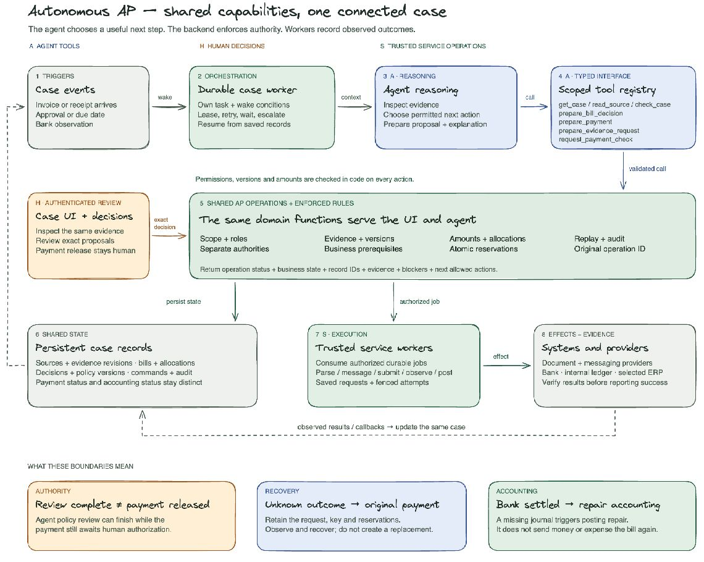

# AP capability abstraction — Excalidraw

Proposed architecture for [issue #97](https://github.com/srivatsav-kannan/autonomous-finance/issues/97), accompanying the [capability matrix, permissions, failure behavior and acceptance gates](https://github.com/srivatsav-kannan/autonomous-finance/issues/97#issuecomment-6396801545).

Download `ap-agent-abstraction.excalidraw` and open it in Excalidraw to edit all 79 elements. The PNG is a verified capture of that drawing. `build-diagram.py` regenerates the native scene.

## Why these boundaries fit the connected case

1. **One guarded domain API for both UI and agent.** A button and a tool call use the same AP operation, current records, policy and validation. This prevents a second implementation with weaker checks. Tools are narrow, typed adapters over business capabilities, not arbitrary database or bank access.
2. **Separate reasoning from authority.** The agent selects useful next actions from its assigned capabilities. The backend derives identity and scope from trusted authentication and checks permission, segregation, dependency versions, balances and policy on every call. Hidden tools are not the security boundary. Human decisions and credentialed service effects remain separate surfaces.
3. **Make progress durable.** Events wake a saved case task. The case worker owns leases, budgets, waiting, retries and escalation; the model does not have to remember a long-running process. Duplicate, late and missing notifications are handled through saved cursors and rechecks. A lease alone cannot retract external I/O already in flight.
4. **Keep one case view over linked records.** Sources, evidence revisions, bills, allocations, approvals, payment commands, observations and journals retain their own identity. Shared state supports partial receipts/payments and many-to-many allocations without collapsing everything into one status. A new receipt invalidates affected checks and wakes the same case.
5. **Execute external effects from persisted, authorized intent.** Service workers perform only approved work with scoped server credentials. Persist the request before dispatch; retain operation identity and apply provider-specific replay/lookup rules. Unknown outcomes stay unknown and escalate when safe recovery is unavailable.
6. **Return facts an agent can act on.** Results include operation status, separate business state, affected records/revisions, evidence, blockers, owners and permitted next actions. `completed` can mean a review finished while the payment still awaits human authorization. `prepare_payment` is a saved mutation with reservations; it is not a harmless preview.
7. **Verify outcomes and enable capabilities in stages.** Authenticated observations update the same records and wake the next step. Keep internal accounting, bank settlement and external ERP sync distinct. The matrix's G0–G4 gates and applicable T/U tests determine activation; unsupported extensions stay disabled with an owned blocker.

## Three concrete consequences

- **Review complete ≠ payment released:** a successful agent policy review still awaits authenticated human authorization of the exact current payment snapshot.
- **Unknown bank outcome → recover the original payment:** retain the saved request/key and reservations; observe or safely resume under provider rules. Do not mint a replacement command because a response was lost.
- **Bank settled → repair accounting:** a verified posted bank transaction with a missing settlement journal triggers accounting repair. It does not send money or recognize the purchase expense again.

This drawing summarizes the matrix; it does not grant runtime permissions, enable integrations, or claim that the specified tests have passed. The registry labels are a representative subset, not the complete capability list.
