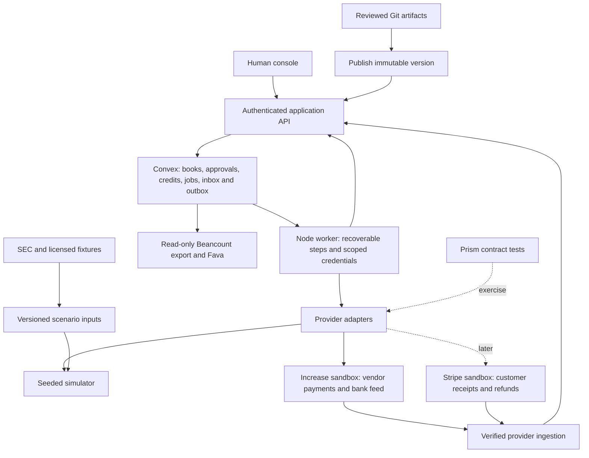

# Finance backend and integration design

Status: **proposed; design only**. Date: 2026-10-23.

Implementation tracking: [Issue #37](https://github.com/srivatsav-kannan/autonomous-finance/issues/37).

Baseline reviewed: `9183d48c6921a1e1c08ea6c7fe011edad0ca56e9`.
This proposal defines the next implementation boundaries. It does not claim that
the adapters, controls, deployment profiles, or acceptance tests below exist yet.

## Decision

Keep **Convex as the sole authoritative application ledger and workflow store**
for the first implementation. Retain the Node agent worker, but make its progress
recoverable from Convex. Use **Increase sandbox as the first external banking
adapter**, using outbound ACH credit for a narrow accounts-payable flow. Keep the seeded simulator as the
default reproducible environment.

Introduce provider interfaces before adding integrations. Add **Prism contract
tests** when the first HTTP adapter exists, and a **Beancount export with optional
Fava review** for accounting inspection. Treat the other products below as
explicit alternatives or later extensions, not dependencies of the first demo.

The first complete story is: receive an invoice and receipt, match them, reserve
any vendor credit, request independent approval, submit one payment, observe its
bank status, reconcile its statement entry, and explain the outcome. A duplicate
invoice, changed beneficiary, ambiguous timeout, and returned payment must each
have a demonstrable outcome. Start with AP, controller, and payments agent roles,
plus an authenticated human approver; keep the wider org as optional scenarios.

This is a small set of application modules plus an external worker, not a new
service per seat or provider. No live-money integration is included in this plan.

## What exists and what needs to change

| Current implementation | Required boundary |
|---|---|
| `convex/ap.ts` can insert a bill before a later posting failure | Bill, credit allocation, journal and idempotency result commit together, or none of the business writes commit |
| `src/agents/handlers/payments.ts` marks submitted, calls `WorldBank.send`, then settles immediately | Durable submission command; separate provider acceptance, settlement, and reconciliation |
| `src/world/bank.ts` writes `bank-outbox.json` | Keep this explicitly simulated; operational command progress belongs in Convex |
| `src/agents/team.ts` polls from a Node process | Restartable worker with fenced leases, persisted checkpoints, bounded retries and recovery scans |
| Vendor credits and remit-to details live in mutable Git YAML | Transactional credit allocations and active beneficiary versions in Convex; Git retains reviewed artifacts and history |
| `src/human/gateway.ts` acts with a shared human-CFO seat token | Authenticated human identity with server-side authorization on each decision |
| Queries often accept only `runId` | Verify principal and organization access; `runId` remains a scenario namespace |
| `src/evals/score.ts` checks selected balances | Full selected-scenario account coverage, source-document disposition, and provider reconciliation |

Related defects remain tracked individually: [transaction rollback #1](https://github.com/srivatsav-kannan/autonomous-finance/issues/1),
[cash provenance #4](https://github.com/srivatsav-kannan/autonomous-finance/issues/4),
[credit reuse #17](https://github.com/srivatsav-kannan/autonomous-finance/issues/17),
[payment recovery #19](https://github.com/srivatsav-kannan/autonomous-finance/issues/19),
[close completeness #24](https://github.com/srivatsav-kannan/autonomous-finance/issues/24),
[approval ordering #27](https://github.com/srivatsav-kannan/autonomous-finance/issues/27),
[gateway authentication #28](https://github.com/srivatsav-kannan/autonomous-finance/issues/28),
and [evaluation coverage #31](https://github.com/srivatsav-kannan/autonomous-finance/issues/31).

## Component placement

The diagram describes dependencies and data flow. Workers use authenticated,
scoped public entry points; server-only helpers use internal Convex functions.
External workers cannot call internal functions directly. Provider webhooks enter
through an authenticated provider-specific endpoint, never through a human seat.
Sandbox lifecycle controls (for example, simulating a settled transfer) belong to
the test harness only. They must not be exposed as agent tools or accessible using
worker-held credentials. If a provider cannot separate those permissions, isolate
the credential behind an allowlisted adapter service; agents cannot call it raw.

### Every proposed tool has a role

"Selected next" means selected for implementation after prerequisite controls,
not already integrated or verified against a running service.

| Tool | Placement and useful capability | Decision and boundary |
|---|---|---|
| [Stripe sandboxes](https://docs.stripe.com/sandboxes) | External customer-payment environment; exercise receipt/refund/dispute events through a `ReceiptsProvider` | Later revenue slice. Do not treat a Stripe customer PaymentIntent as an AP vendor-payment intent or a generic bank transfer |
| [Increase sandbox](https://increase.com/documentation/sandbox) | External banking environment behind `BankingProvider`; outbound transfers, status and bank activity | **Selected next** for AP. Use simulated lifecycle controls and sandbox credentials; acceptance is not settlement |
| [Lago](https://getlago.com/docs/guide/lago-self-hosted/docker) | Upstream usage/subscription billing source behind `BillingSource` | Deferred until a usage-billing scenario exists. Generated invoices are inputs, not our ledger or payment authority |
| [Odoo](https://hub.docker.com/_/odoo) | ERP fixture/source environment behind `ProcurementSource` | Deferred alternative for suppliers, purchase orders, receipts and bills. Choose one ERP; import business documents rather than duplicate its accounting system |
| [ERPNext](https://github.com/frappe/frappe_docker) | Alternative ERP fixture/source environment behind the same procurement boundary | Deferred alternative to Odoo, not a second mandatory ERP. Pin and seed the chosen environment reproducibly |
| [Formance Ledger](https://github.com/formancehq/ledger) | Potential future authoritative posting engine behind `LedgerPort` | First candidate if a separate ledger is justified. Requires explicit cutover; never a concurrent second authority |
| [Blnk](https://docs.blnkfinance.com/home/install) | Alternative external ledger behind `LedgerPort` | Evaluate instead of Formance, not alongside it. Validate accounting, idempotency and operational requirements in a separate spike |
| [TigerBeetle](https://docs.tigerbeetle.com/start/) | Specialized accounts/transfers engine behind `LedgerPort` | Deferred unless measured workload or balance constraints justify it. Application still owns approvals, documents, periods and accounting interpretation |
| [Beancount and Fava](https://github.com/beancount/fava) | Export validation and read-only accounting review | **Selected next** after kernel fixes. Beancount parses/checks an export; Fava presents it. Neither submits payments nor writes back to the operational ledger |
| [Mockoon CLI](https://github.com/mockoon/mockoon/blob/main/packages/cli/README.md) | Optional controllable HTTP fixture/fault server | Deferred until bespoke timeout/status scenarios exceed the in-process fake. Avoid maintaining the same contract in both Mockoon and Prism |
| [Prism](https://github.com/stoplightio/prism) | OpenAPI request/response contract checks at adapter boundary | **Selected next** with the HTTP adapter. Pin the supported specification subset; schema conformance does not establish correct banking behavior |
| [stripe-mock](https://github.com/stripe/stripe-mock) | Stripe-specific response-shape/SDK smoke tests | Optional in the Stripe slice only. Stateless behavior cannot prove lifecycle, retry, settlement or reconciliation correctness |
| [SEC EDGAR](https://www.sec.gov/search-filings/edgar-application-programming-interfaces) | Public filings and XBRL calibration inputs | Keep for aggregate company context. Filings are not transaction-level supplier invoices or bank-statement truth |
| Public GitHub repositories | Licensed, versioned source documents, OpenAPI specs or benchmark fixtures | Optional inputs with repository URL, commit, path, license and checksum. Public accessibility alone is not permission to redistribute |

Fava's read-only role is our integration restriction, not a property of the
product: serve generated snapshots without write access and disable/restrict
editing endpoints. See the [Beancount documentation](https://beancount.github.io/docs/)
for the export format and [GitHub licensing guidance](https://docs.github.com/en/repositories/managing-your-repositorys-settings-and-features/customizing-your-repository/licensing-a-repository)
for fixture reuse.

The existing [team plan](TEAM.md) also proposes Capital One Nessie. It remains an
alternative `BankingProvider` if sponsor requirements make it the preferred rail;
Increase is the default choice for this proposal's first adapter. Require the same
contract suite for either. Select exactly one outbound provider per intent; an
ambiguous payment must never fail over to a different provider.

## Data ownership and consistency

| Data | Authoritative owner | Other representations |
|---|---|---|
| Bills, credit allocations, approvals, active beneficiaries, internal journals, periods | Convex | Console queries and accounting exports are projections |
| Whether the external provider accepted, settled or returned a transfer | Provider | Convex stores authenticated observations and reconciles its internal books |
| Jobs, attempts, retry times, idempotency outcomes, provider inbox/outbox | Convex | Worker memory is disposable |
| Reviewed policies, parser code, playbooks and historical decision artifacts | Immutable Git commit/artifact | Convex records the activated version and decision references |
| Raw imported documents and provider payload evidence | Durable artifact storage, content-addressed | Convex stores digest, access scope, provenance and references |
| Synthetic truth and planted-error answer key | Evaluator-controlled fixtures | Never exposed through agent tools or provider adapters |

Amounts use bounded safe integer minor units and explicit currency; phase one is
USD only. Validate both line amounts and aggregate sums. Separate `orgId` (access
boundary) from `runId` (scenario) and provider environment/account identity. Index
queries by that scope. A provider account and transfer ID cannot silently bind to
two active runs. No floating-point currency arithmetic or implicit FX conversion.

Convex mutations have transactional database writes, but returning `{ok:false}`
does not roll back prior writes. Validate business preconditions before writing;
then apply all business writes in one mutation. An unexpected failure throws and
rolls back. If rejection logs must survive, write only the rejection record on a
pre-validation failure, or use an explicitly isolated logging path; never retain
a half-created bill to preserve a log. See [Convex transactions](https://docs.convex.dev/functions/mutation-functions#transactions).

Activate knowledge in two steps: store and review an immutable artifact first,
then atomically publish its digest/version in Convex. Each decision pins that
version. A Git merge alone does not activate a bank account or policy. Store credit
balances/allocations and the active verified beneficiary reference in Convex so
reservation and payment authorization read a consistent version. Keep sensitive
account details in the provider's protected beneficiary resource, not Git history.

Each public read/write checks identity, organization and role. Human approval
stores the real approver, target version, policy version and decision. Validate the
ask, its offered option and expected state before atomically applying the answer
and its business effect. Reject replay with a conflicting option. Enforce stored
capability restrictions as well as role defaults; requester and required approvers
remain distinct. [Convex identity API](https://docs.convex.dev/auth/functions-auth).

## Adapter contracts and proposed code locations

These paths and interfaces are implementation targets, not existing modules.

| Proposed module | Contract |
|---|---|
| `src/integrations/contracts.ts` | Versioned envelopes, money/currency types, provider capability declarations and normalized errors |
| `src/integrations/banking/{world,increase}.ts` | `submitTransfer(command)`, `getTransfer(providerId)`, recovery lookup by stable command identity, paginated `listTransactions(cursor)` |
| `src/integrations/receipts/stripe.ts` | Later: receipt/refund/dispute ingestion and provider event normalization |
| `src/integrations/procurement/` and `billing/` | Later: source documents, upstream IDs, amendments and sync cursors |
| `src/core/ledger-port.ts` | In-transaction posting contract with a Convex implementation; no HTTP calls from a Convex mutation |
| `src/exports/beancount.ts` | Read-only export at a fixed ledger sequence, with account mapping and evidence identifiers |
| `convex/providerInbox.ts`, `providerOutbox.ts`, `beneficiaries.ts`, `credits.ts` | Durable ingestion, dispatch, approved payee versions and allocations |
| `test/contracts/`, `test/scenarios/`, `fixtures/` | Contract checks, stateful behavioral tests and provenance manifests |

Normalize inbound events to: schema version, organization/run, provider,
environment/account, external event ID, event type, source occurrence time, receipt
time, amount/currency when applicable, and raw-evidence digest/reference. Deduplicate
by provider/account/environment/event ID within its bound scope, not by delivery
timestamp. Persist the inbox event and initial processing job atomically. Polling
and webhooks feed the same normalization and deduplication path. Cursor advancement
commits with the corresponding imported page, so a crash can safely replay it.

The bank command contains the immutable intent/version, verified beneficiary
reference/version, amount/currency, request fingerprint and provider idempotency
key. Credentials and provider endpoints come from trusted deployment configuration.
Agents may request business actions; they cannot choose arbitrary destinations,
credentials or raw provider calls. Unsupported provider capabilities fail explicitly.

Do not force provider states into a single boolean `success`. Preserve raw status
and normalize accepted/pending, settled, failed, returned and unknown separately.
Define mappings and evidence requirements per adapter and pin API/spec versions.

## Payment execution and failure recovery

Keep three separate state dimensions:

- **Intent:** draft → pending approval → approved; rejected/voided only under the
  applicable pre-submission rules. Approval binds to amount and beneficiary version.
- **Execution:** queued → submitting → accepted/pending → settled; alternatives
  are failed before acceptance, unknown outcome, or returned. A return may be
  observed while local state is pending/unknown; settlement need not arrive first.
- **Reconciliation:** unmatched → matched, or exception. Settlement alone does
  not mean the bank statement has been reconciled.

Before requesting approval, persist an immutable intent version containing the
bill set, per-bill amounts, credit allocations, currency, net amount, beneficiary
version and policy version. Approval binds to that complete snapshot. A change
to any field requires reapproval; unavailable credit causes a hold, not silent
recalculation of the approved payment.

1. In one mutation, validate independent approvals, current beneficiary/policy,
   the approved bill/allocation snapshot and available credit; reserve the obligations and create one
   immutable outbox command. Allocate its stable provider idempotency key here.
2. A worker claims a command using a lease generation/token. Persist the attempt
   before the external call. Lease expiry allows recovery; stale workers cannot
   finish or fail a newer attempt. Provider idempotency is still necessary because
   a lease cannot retract an external request already in flight.
3. Call the provider outside the database transaction. Persist the provider ID and
   observed state. HTTP success/acceptance does not post settlement automatically.
4. On a timeout or crash around submission, mark/recover an unknown outcome. Query
   provider evidence or replay the exact request with the same key under the
   provider's documented policy. Never create a new intent/key just to retry. If
   evidence or the provider's idempotency window is insufficient, keep the amount
   reserved and raise an exception for reconciliation; do not automatically resend.
5. Verify webhook authentication according to the provider contract; also poll
   pending/unknown transfers and bank activity. Duplicate and out-of-order events
   cannot regress state or double-post. A webhook arriving before the submit
   response is retained and linked by stable identity during recovery.
6. Validated economic events and their accounting entries commit atomically,
   keyed by provider transaction identity and posting purpose, not webhook delivery
   or a status label. A return is a separate economic event. Retrieve the original
   debit and return transactions; compensate only an existing original posting,
   or atomically import both verified postings if the return was observed first.
   Missing evidence leaves a reconciliation exception, not a fabricated reversal.
   Keep the final returned state while importing earlier missing economic events.
   Release/reuse reservations only under verified state; never delete old journals.
7. Match statement activity to the existing settlement entry. A match adds evidence;
   it does not post the same cash movement again. Unmatched entries block a clean
   close until dispositioned under policy, with any exception approval recorded.

Example for a $100 USD vendor bill without a credit: recognize debit expense /
credit AP for 10,000 cents; on confirmed settlement debit AP / credit cash for
10,000; reconcile the statement debit without another cash posting. A confirmed
return restores previously settled AP with debit cash / credit AP, with fees
separately evidenced. This reversal requires the corresponding original posting.
Corrections after a locked period post in an allowed open period and reference the
original event. The exact provider-to-accounting mappings require adapter tests.

For Increase outbound ACH, the raw transfer status remains `submitted` after
settlement; there is no raw `settled` status to wait for. Require the settlement
details (`settlement.settled_at`) and corresponding posted Transaction evidence.
Return handling reconciles the distinct return Transaction as well as the original
debit, even if notifications arrive in the opposite order. See the
[ACH lifecycle](https://increase.com/documentation/sending-ach-transfers) and
[Transactions versus Transfers](https://increase.com/documentation/transactions-transfers).

Use a supervised Node worker first, with indexed recovery scans, retry backoff,
attempt limits, heartbeats and a visible exception queue. Scheduling a recovery
check from a Convex mutation can be atomic with its state update. Convex actions
may perform external calls, but do not make those calls transactional or retry-safe
automatically. [Scheduling semantics](https://docs.convex.dev/scheduling/scheduled-functions)
and [action error handling](https://docs.convex.dev/functions/actions#error-handling).

Increase has provider idempotency support, but its sandbox does not retry failed
webhook deliveries. Implement and test recovery polling regardless of webhook
availability. See [idempotency](https://increase.com/documentation/idempotency-keys)
and [webhook behavior](https://increase.com/documentation/webhooks).

## Why not replace Convex with a ledger now?

The immediate defects concern business transitions, authorization, completeness
and recovery. A separate ledger does not decide whether a supplier invoice is
valid or an approval is genuine. Keeping bill/credit/journal writes in one Convex
transaction avoids a distributed commit boundary during the first repair phase.

`LedgerPort` initially describes local posting semantics. An external implementation
would require a different execution boundary: Convex records a posting command,
an external worker submits it, and Convex applies an acknowledged projection.
Do not present a remote call as an interchangeable in-transaction helper.

Evaluate Formance first only if operational requirements justify that trade-off.
Use Blnk as an alternative in that evaluation. Consider TigerBeetle if measured
throughput or transfer/balance constraints warrant it; it is not a replacement for
all ERP/accounting application logic. Pin exact releases before choosing a topology.
No performance claim or provider compatibility certification is made here.

A future migration requires: explicit chart/currency/period/reversal mappings;
the same invariant suite; replay into a non-authoritative comparison environment;
full account and event reconciliation; and a controlled writer freeze/checkpoint
before switching the sole authority. After cutover, Convex journals/balances are
read projections and cannot accept independent postings. A failed cutover keeps
the old authority; it does not enable dual writes or a blind rollback after new
external postings.

## Test environments and truthful evidence

| Proposed profile | Purpose | What it cannot prove |
|---|---|---|
| `local-sim` | Default: local Convex, worker, seeded world, persistent simulated bank lifecycle and restart tests | Provider compatibility or real settlement |
| `contract` | Adapter requests/responses checked against pinned OpenAPI fixtures with Prism | State transitions, financial correctness or provider availability |
| `sandbox-increase` | Isolated Convex deployment, worker, Increase test account and verified ingestion endpoint | Live-money behavior; also requires explicit failure injection beyond sandbox defaults |
| `accounting-export` | Fixed-sequence Beancount validation and optional read-only Fava UI | Completeness of omitted source documents or correctness of business intent |
| Later optional profiles | Stripe receipts, one ERP source, or Lago billing | No profile inherits another profile's passing status |

These names are proposed configuration profiles, not runnable commands in this PR.
Pin dependencies, service images and API specifications in implementation PRs.
Keep provider test credentials out of Git, agent context and fixture payloads.
Explicitly configure environment and provider-account binding; never silently
switch from a sandbox to live credentials or from a provider failure to simulation.

The worker needs a deployment independent of the frontend: durable Git/artifact
storage, restart supervision and scoped credentials. Convex deployment alone does
not deploy the worker, its files or optional Docker services. For sandbox runs,
store operational state in Convex and artifacts in durable storage; local files
may cache them but cannot be the only recovery record. Isolate generated parser
execution from provider credentials and the evaluator's answer key.

Report each layer separately: simulated behavioral tests, HTTP contract tests,
provider sandbox tests, accounting export checks and source coverage. Show seed,
time window, provider/environment and API version, application commit, fixture-set
hash, contract/specification version or hash, and policy/artifact versions. A missing
credential produces **not run**, not pass. Schema-valid mocked responses and a
balanced export cannot establish that every invoice was processed.

Seed fault injection as well as business-data generation, and persist the fault
schedule. The current emitter uses `Math.random()` for duplicate delivery; replace
that in the reproducible profile. A replay must reproduce the same fault sequence,
not only the same invoices. The simulator's bank state must also survive restart
and serialize concurrent changes before it can serve as a recovery-test oracle.

Fixture manifests record origin URL, retrieval date, content hash, license or
permitted use, source version, transformations, and an explicit origin class:
public filing, licensed sample, provider-sandbox, or synthetic. Provider-sandbox
records must not be relabeled as real operational data. SEC fixtures also include CIK, accession, form, reporting period,
taxonomy concept and units. GitHub fixtures pin repository/commit/path; do not
execute downloaded code as data ingestion. Cache EDGAR server-side, identify the
client and respect SEC access guidance. Preserve held-out fixtures and keep their
answer keys out of agent-visible storage and tools.

## Implementation order and acceptance gates

| Phase | Deliverable | Required evidence before moving on |
|---|---|---|
| 0: kernel and identity | Atomic business transitions, credit allocation, beneficiary versions, authenticated reads/approvals, close blockers | Existing defect repros fail safely; rejected operations leave no business writes; conflicting approval replay has no side effect |
| 1: interfaces and recovery | World adapter, inbox/outbox, lease fencing, state machine, restartable worker | Crash injection before/after every external-call boundary, duplicate events, stale lease and concurrent workers produce one economic effect |
| 2: first provider | Increase sandbox adapter plus Prism contract suite and account/environment isolation | One bill goes through independent approval, provider acceptance, settlement and statement match; timeout and return scenarios recover with evidence |
| 3: accounting proof | Beancount export/Fava option and complete AP-scenario evaluation | Every source document has a disposition; all relevant accounts and allocations reconcile; provider state and books agree at a fixed checkpoint |
| 4: optional sources | Stripe receipts, then one ERP or Lago only for a named scenario | Each adapter passes its own contract, lifecycle and reconciliation tests; no added service without a demonstrated scenario |
| 5: optional ledger evaluation | Version-pinned Formance/Blnk or TigerBeetle spike if justified | Measured need, accounting equivalence, failure recovery and a single-authority cutover plan |

Phase 0 reuses the existing audit issues rather than duplicating them. The small
fix PRs already opened remain independent prerequisites where relevant; this design
does not imply they have merged or that the remaining defects are resolved.

Minimum cross-layer acceptance cases:

- Reject an invalid invoice date/posting atomically; reserve each vendor credit
  once across concurrent bills; reject duplicate bill IDs and repeated payments.
- Reject unauthenticated and cross-organization access, forged human approval,
  approval of a changed intent, and stale task completion/failure.
- Simulate crash before send, provider acceptance with lost response, crash before
  storing the response, duplicate/out-of-order webhook, missing webhook, rate
  limit and temporary outage. Recover or surface an explicit unresolved exception.
- Keep a submitted/unknown payment reserved; repeated cancellation cannot clear
  another intent's reservation. A provider failure never triggers another rail.
- Import paginated bank activity with a crash between pages and duplicate delivery;
  reconcile each cash movement once, including a return observed before settlement
  evidence or after worker restart. Missing debit evidence must not create a reversal.
- An unreadable invoice, unresolved payment, or unexplained bank item prevents a
  clean close. Report these separately from parser accuracy and planted-error recall.
- Balance the export by currency and account, then separately compare the full
  source-document register and bank evidence. A balanced incomplete ledger fails.

The architecture issue remains open through the required phase 0–3 gates. Phases
4–5 are optional follow-up work, not prerequisites for closing the initial issue.
A merged design PR records a decision; it does not complete the integrations.
