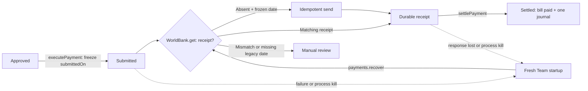

# Submitted payment recovery (#19)

A worker restart now resumes `submitted` payment intents. It looks up the saved bank receipt before sending anything: an existing matching receipt proceeds directly to settlement; an absent receipt retries the original command through WorldBank's idempotent interface. Convex remains the system of record for payment state, tasks and ledger entries.

`executePayment` freezes `submittedOn` from the run's simulation date on the first approved-to-submitted transition. Recovery preserves the submitted payee, amount, bank account and date even if the simulation day or vendor memory changes. It validates the receipt against those fields and uses the receipt's `sentOn` for settlement. A repeat settlement with different bank evidence is rejected.



## Startup and retry behavior

Each fresh `Team` checks once for submitted intents and queues a priority-1 `payments.recover` task when needed. This happens in ordinary `runUntilIdle()` startup; recovery does not require a new `day.end`, an administrator-created task, or waiting for an old worker's lease to expire. Normal payment runs also process submitted intents before approved ones. A failure on one intent does not prevent attempts on other intents.

Errors use the existing task retry mechanism: up to four attempts per task, with a one-second delay for thrown errors. Drain mode waits for queued payment retries instead of reporting idle before their deadline. After exhaustion, the task remains failed and the intent remains submitted for inspection. This is a **per-task limit**, not a lifetime limit per intent: an original execution task and a new startup recovery task can both retry, and another fresh startup can queue another recovery task. The permanent-failure fixture recorded eight attempts across two failed tasks, four attempts each.

An older submitted intent without `submittedOn` can recover from an existing matching receipt using its saved date. **If it has neither a frozen date nor a receipt, it requires manual review**; recovery does not invent a new dispatch date or send another command. Receipt conflicts and closed-period posting failures likewise remain visible rather than marking the payment settled.

## Run the checks

```bash
npm test
npm run typecheck
```

For the nine integration cases, keep a local Convex backend running with this checkout's functions and schema deployed (`npm run backend`). Set `CONVEX_URL` to its loopback URL and configure the same `KERNEL_ADMIN_SECRET` in the backend and local environment, as described in the repository README. Then run:

```bash
npm run test:payment-recovery
```

The integration harness requires a loopback backend, disables LLM calls, creates isolated run IDs and local fixtures, and uses separate Node worker processes. Fault injection exists only in the test worker. It writes detailed evidence to `var/payment-recovery-results.json` and per-run `recovery-report.json` files. `PAYMENT_RECOVERY_REPORT` can override the aggregate output path.

## Verified results

After rebasing onto `main` at `adbe32c`, verification on **October 23, 2026** passed all nine cases against local Convex at `http://127.0.0.1:3230`, all 189 offline tests, 42 kernel/memory smoke checks, and both application and Convex TypeScript checks. The nine live tests are opt-in and appear as skipped in ordinary `npm test`; they passed separately via the live command above. Each live case starts with one $50 bill. “Transfers” below means persisted simulated bank receipts, not calls to `send` that threw before acceptance.

| Case | Restart result | Final transfers / settlement entries |
|---|---|---|
| `before-send` | Failure before acceptance; restart sends the saved command. | 1 / 1 |
| `lost-response` | Bank accepted, response lost; restart finds receipt and makes zero send calls. | 1 / 1 |
| `settle-failure` | Failure before settlement mutation; restart posts from receipt with zero send calls. | 1 / 1 |
| `kill-after-send` | Actual `SIGKILL` after bank acceptance; fresh process settles with zero send calls. | 1 / 1 |
| `success-replay` | Already settled; fresh startup and replay make zero send calls. | 1 / 1 |
| `changed-remit` | Vendor details change after acceptance; original receipt and destination remain authoritative. | 1 / 1 |
| `changed-remit-before-send` | Vendor details change after failed dispatch; restart sends the original frozen destination and date. | 1 / 1 |
| `permanent-bank-failure` | Both tasks exhaust four attempts; intent stays submitted and no money is recorded as moved. | 0 / 0 |
| `closed-period` | Accepted transfer remains recorded; settlement is blocked by period policy, with no resend. | 1 / 0 |

For the seven successful/replayed cases, the restart advanced simulation time from January 10 to January 11, while both bank and settlement dates stayed January 10. Each finished with a paid bill, exactly two journal entries (accrual plus settlement), a verified hash chain, balanced trial balance and a reconciled next-day bank feed. Further replay did not change the receipt, intent or journal count; the bank match added no second cash entry. Live checks also verified that an AP clerk cannot settle or replay settlement, identical authorized settlement replays succeed, and changed bank references or dates are rejected without changing the ledger or intent.

The kill case is an operating-system process kill, not a caught exception: its evidence records `first.signal: "SIGKILL"`, `first.bankAccepted: true`, `restartSendCalls: 0`, `bankTransfers: 1` and `settlementEntries: 1`. The two blocked cases retained one accrual journal and a verified chain, with no settlement entry. They passed by stopping safely and preserving the unresolved state.

WorldBank unit tests additionally kill separate processes during a receipt write and immediately before/after publication, race concurrent senders for the same and different intents, reject changed command fields, and verify legacy data is preserved.

Legacy missing-date handling is covered with mocked kernel responses, not migrated Convex records. Concurrent receipt publication is tested across processes; simultaneous full Team recovery races and a Convex server restart are not exercised. The lost-response fixture models acceptance followed by a local exception, not a real provider/network failure.

## Storage and scope

WorldBank is a **local simulated bank**: acceptance creates a durable receipt and the handler immediately records simulated settlement, before the next-day feed arrives. This is not evidence of real bank settlement finality.

New receipts live at `var/runs/<runId>/bank-outbox/<SHA256(intentId)>.json`. WorldBank writes and fsyncs a unique temporary file, publishes it with an atomic hard link, and fsyncs the directory. Concurrent identical commands replay the winning receipt; changed payee, amount, bank, last four digits or date produce an idempotency conflict. Unpublished temporary files left by killed processes are ignored. Existing `bank-outbox.json` data remains readable and unchanged; old/new records are deduplicated, and corrupt or conflicting data fails closed.

This protocol requires a local POSIX filesystem supporting atomic hard links and directory fsync. **Do not run concurrent old-version writers** that still rewrite `bank-outbox.json`. Network/distributed filesystems, disk loss and machine power-loss behavior are outside the process-kill evidence recorded here.

Issue #19 keeps the Convex architecture and fixes submitted-payment recovery. Real bank/provider adapters, asynchronous acceptance or settlement statuses, provider webhooks, returns, and cross-system reconciliation need separate contracts. Approval routing, human-answer handling, invoice coverage and period-close readiness are also separate issues; passing these recovery checks does not certify the entire finance workflow.
