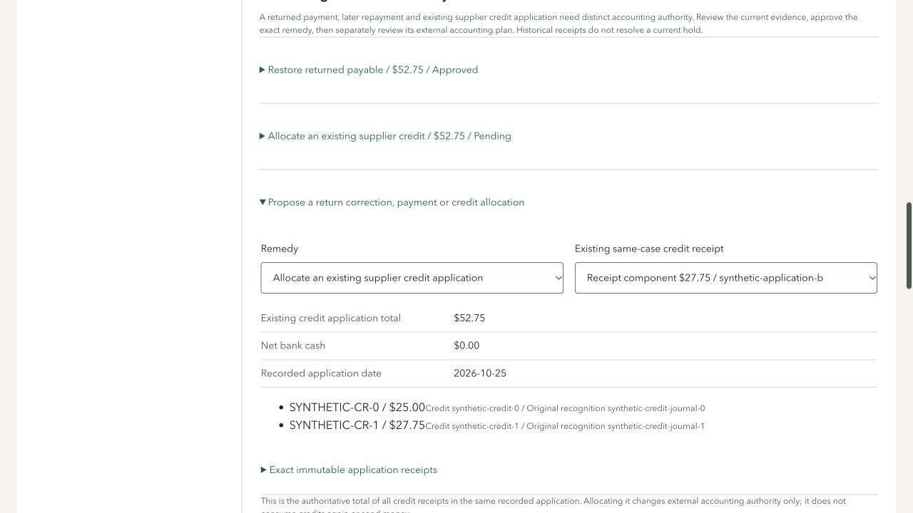
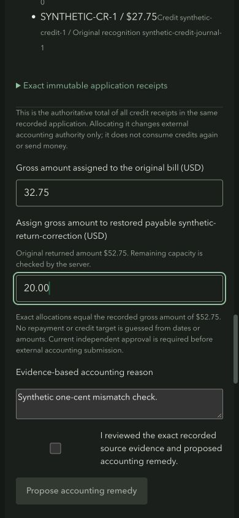
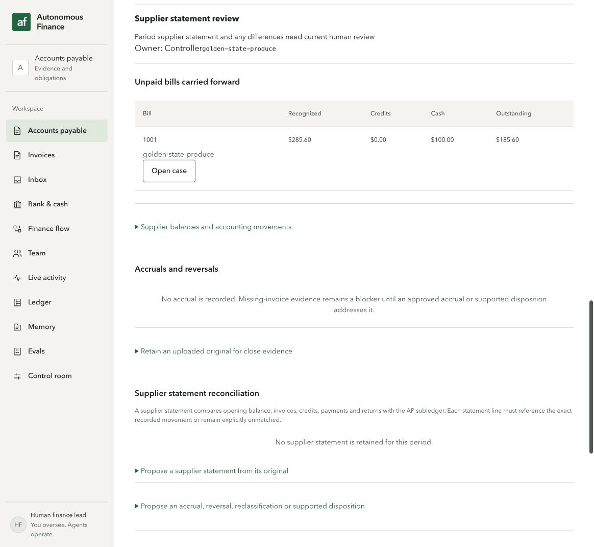

# Root browser checks: period export, corrected cost and restored credits

These CUA observations use the integrated synthetic UI fixture on port5194. The page explicitly states that documents, people, approvals and requests are synthetic and no backend/provider operation is connected. Period-QBO checks used003ebcd, cost/grouped-credit checks1cd4cc5, and negative/responsive credit checks2154234. Exact checks and image hashes are in [the report](D2-browser-final.json).

An approved period accrual produces a $20 JournalEntry preview. External submission and its confirmation are disabled in Local FakeBank. Opening AP/accrual/cash review inputs start blank, with the close confirmation unchecked; displayed ledger numbers are not silently adopted as reviewed opening evidence.

The corrected-cost form requires explicit original shares, reachable reviewed accounts, amounts, retained evidence, reason and confirmation. The corrected browser accrual is exactly$20, with$10 in expense and$10 reclassified to inventory. A reviewed$10 reversal plan can be attached to a one-unit draft; changing quantity clears the plan and disables proposal until reviewed again. This is form behavior, not a posted reversal. Independent V6 additionally caught signed account-capacity/date problems; targeted repairs are integrated2154234 and are being replayed separately.

Selecting a$27.75 credit receipt loads its complete$52.75 application group ($25+$27.75), shows$0 bank cash, and preserves both recognition references. A$32.75 original-bill/$20 restored-payable split passes the exact sum gate after explicit confirmation. A one-cent short split stays disabled. Editing the amount clears confirmation. Phone width390 had document width390, no alerts, and legible light/dark fixture palettes; desktop width1280 was also checked. Palette switching verifies fixture CSS, not OS theme preference behavior.

Separately, the actual persisted I2 case remains open at AP GL$185.60, supplier subledger$185.60, difference$0. Its6 blockers preserve the disputed portion,4 received-but-not-invoiced SKU balances and missing supplier-statement review. The [read-only HTTP evidence](I2-close-readback.json) and screenshot below do not claim a completed close, invented opening bank reconciliation, real Auth0, Increase, QuickBooks transaction or practitioner approval.

