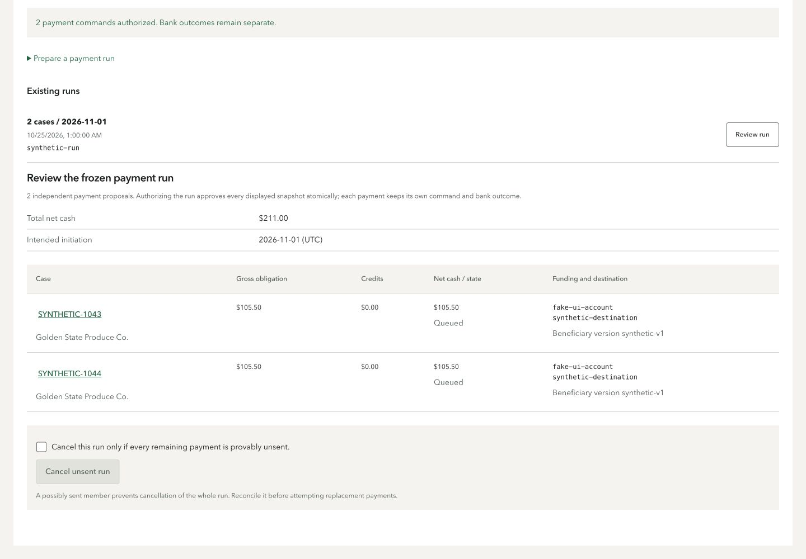

# D2 operations implementation checkpoints

This is engineering evidence, not external workflow, practitioner or D2 acceptance. Canonical registry remains Master-owned.

## Checkpoint 1

Base `6114a03`, branch `codex/ap-system-d2`.

- Payment-run list/detail/prepare/authorize/cancel HTTP and browser API seams use the existing authenticated session, subject and origin/CSRF checks. Requests accept distinct one-to-25 case bindings and validated optional partial amounts, credits and calendar date. Existing backend run mutations own atomic authorization and idempotency.
- QuickBooks readiness/preview/submit/verify HTTP/API and case panel compose the current request's human Convex client through the existing `createQBOBridge`. Browser-supplied exports/payloads are rejected. Submit requires the reviewed preview hash. Local FakeBank external writes and verification are blocked; explicit mapped previews remain possible.
- Accounting status and provider receipts remain independent of bank execution. External IDs display only from successful receipts. The case panel no longer reports “not connected” before querying the actual accounting connection.
- Eligible-looking payment proposals expose an explicit cancel confirmation; the server remains authoritative about whether sending may have begun. Cancellation never silently creates/re-authorizes a replacement proposal.
- QuickBooks setup now leads with normal Auth0 browser login, with no manual JWT in the user path.

Validation: main and test typechecks pass; 24 targeted HTTP/UI tests pass; console build passes (existing large main-chunk warning remains); static design check 0 FAIL/0 WARN, one existing answered F7; diff whitespace check passes. All HTTP tests use explicit service doubles; no backend/bank/QuickBooks writes occurred.

Remaining D2 work: payment-run selection/review UI, operational summaries/narrative/related-case navigation, B3 governance/acceptance/credit UI once integrated, QBO B3 credit/application/correction holds once C4 contract lands, focused new regressions and responsive light/dark CUA evidence. This first checkpoint has no browser visual acceptance claim.

## Checkpoint 2 — runs and explicit human allowlist

Payment run selection and frozen aggregate/per-case review now share the AP workspace, with separate authorization/cancel confirmations and related case navigation. Metrics count only known unique invoice obligations and disclose unknown approved amounts. Local request state is preserved while list/session generations refresh. Private AP_HUMAN_SUBJECTS supports explicitly listed distinct approvers; every request still checks current backend binding. No live identity enrollment or configuration was changed.

Fixed a sibling-key collision between APAccounting and APActions by using accounting:/review: prefixes. Focused unit/render/auth HTTP tests: 37 pass; main/tests typechecks and console build pass; static design check 0 FAIL/0 WARN. Responsive CUA render and repeated accounting-tab DOM-count regression remain for the next D2 evidence checkpoint. No integrated or external accounting acceptance claimed.

## Checkpoint 3 — governed business operations

Added request-bound `GET /business`, `GET /business/proposals` and `POST /business/{operation}`. Scope and caller identity cannot be supplied by the browser. AP/controller proposals use explicit server credentials; human decisions use only the current request's human client. Policy proposals require an optional distinct controller capability and fail closed without it.

Matching now exposes an editable acceptance draft with explicit quantity, net/tax, coding, agreement and receipt-line selection; no receipt capacity or tax choice is silently inferred. It presents frozen sequential group/quorum decisions, delegation selection, linked credit proposals and exact credit-only application. Policy & suppliers provides versioned policy groups/bands, chart/tax rules, retained contact evidence, supplier catalog/destination proposal, clearly labeled callback attestation, independent approval and bounded delegation/revocation. Legacy direct bill approval is hidden when governed policy is active. Related case navigation, source/extraction denominators and retained timeline counts use actual projections; no latency or accuracy score is invented.

45 targeted tests pass (HTTP forgery/session, request-owned service routing, allowlist and rendering); main/tests typechecks and console build pass. These checks are engineering evidence. Responsive CUA fixtures, actual-case read-only navigation and external company grant/records remain separate acceptance evidence. No AP backend, identity enrollment, company grant or accounting write was performed by this workstream.

## Checkpoint 4 — current accounting holds and responsive review

The accounting record selector now supports recognized VendorCredit cases, frozen cash/credit settlement versions, and explicit credit-application receipt IDs. HTTP rejects simultaneous payment/application selectors and any browser-supplied payload. Preview shows recognition amount or gross obligation, supplier credit and net cash separately. Current controller-owned return/correction holds remain distinct from historical successful receipts. Original submission subject/hash/time is displayed without relabeling a recovery reader as the approver. No hold-clearing or guessed replacement action exists. API names remain `accountingPreview`, `accountingSubmit`, `accountingVerify`; optional selector now accepts `{paymentVersionId}` or `{creditApplicationId}` (the previous payment-version string stays compatible).

Validation: **51 targeted tests** across domain service/HTTP, auth, rendering and QBO runtime pass; main/tests typechecks and console build pass. Static design check returns 0 FAIL/0 WARN after using the existing hairline treatment for accounting holds. The build reports the preexisting main-chunk size advisory (now ~590 kB), not a compilation error.

CUA was unavailable in the D worker (inventory and isolated-tab calls timed out and reset). Master performed the required CUA review against the exact D preview fixture instead; no standalone browser automation was used. Desktop1440×1000 and mobile390×844 had no document overflow (mobile scrollWidth/clientWidth390/390). Light/dark palettes use the real design tokens in the explicitly labeled fixture; this is not an OS-media-query claim. Repeated Matching→Accounting→Matching→Accounting yielded exactly one “Bill, payment and books” heading and one “QuickBooks accounting sync” panel. The synthetic two-payment run showed $211.00 and2026-11-01UTC; authorization was initially disabled until its checkbox, and a simulated click produced two queued fixture states with the explicit no-external-request banner. Policy/group/contact/delegation forms were visible.

Master separately refreshed the actual I1 case read-only on5190: exactly one books panel and one QBO panel; mapping-readiness notices, no reported errors. No B3 policy was activated on that case; there were no backend or provider mutations in this review. Actual external provider/accounting acceptance remains separate.

Reproducible fixture: [D2-browser/fixture.html](D2-browser/fixture.html), with schema-validated [data.json](D2-browser/data.json). Serve using the owned Vite preview5191 and open `/@fs/<absolute-worktree>/docs/ap-orchestration/evidence/D2-browser/fixture.html?case=synthetic-pending&apView=matching`. Use Fixture palette, Workspace sections, and Case sections controls. All fixture requests are intercepted and never forwarded.

Screenshots are original CUA JPEG bytes (extensions corrected from the transport's temporary `.png` names), with no image alteration:

- [Desktop light](D2-browser/desktop-light.jpg), [desktop dark](D2-browser/desktop-dark.jpg)
- [Mobile light](D2-browser/mobile-light.jpg), [mobile dark](D2-browser/mobile-dark.jpg), [mobile approval route](D2-browser/mobile-approvals.jpg)
- [Run review](D2-browser/run.jpg), [synthetic authorized run](D2-browser/run-authorized-synthetic.jpg), [policy](D2-browser/policy.jpg)

These artifacts demonstrate presentation and interaction checks only. They do not establish real Auth0 identities, callbacks, policy quorum, bank execution or external accounting success. B4 close operations and V4 backend remediation are separate upcoming integration steps.
