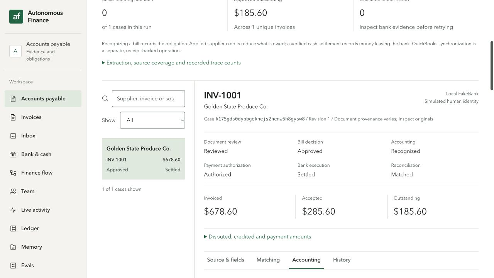

# I2 original-source, multi-human and partial-payment integration

Measured on 2026-10-25 in the separate `ap97-b3-live-20261025` local FakeBank run. Backend3254/3255, gateway8826 and UI5193 are separate from the previously settled I1 run. Five explicit simulated identities are visibly labelled; this does not establish Auth0, Increase, external accounting or practitioner acceptance.

Four actual original PDFs were uploaded through the browser. LlamaParse produced35 fields:33native and2unresolved; original-byte hashes and independent original-derived field expectations passed the HTTP acceptance harness. No expected-answer file is loaded by runtime extraction. The exact readback, source hashes, approvals and journal identities are in [the curated JSON](I2-business-flow.json).

The original invoice remains $678.60. Explicitly accepted units (kale2,romaine2,avocado1,tomato1) total$285.60; $393.00 remains disputed. Field review did not post a bill. The first owner vote retained the pending quorum, the second retained the pending finance stage, and only the final separate finance vote posted the immutable recognition. The UI showed payment not requested after recognition.

Recognition journal `r979g69xn1zq8a6yfryaybst3s8gzvw1` debits account5000 $77.00,$85.50,$68.90,$54.20 and credits AP2000 $285.60. Bill `n577wxmcdgn3t9ygpa1yd4jgc18gzzpz` remains tied to case `k175gds0dypbgeknejs2henw5h8gysw8` and approved proposal `jd77cpnwwck6dgqv3jzztxp3t58gzprf`.

An independently authorized $100 payment scheduled2026-11-02 produced zero transfers and zero posted debits before that date. It was then canceled without an attempt. A second unapproved future-date proposal was also canceled after the automation's native date-field interaction did not update React's intended value; the frozen preview exposed the mismatch before authorization. A newly prepared, separately authorized2026-10-25 snapshot `pd7c8g9q8na2hgnj9wdkaygb4x8gy7fv` subsequently settled via the local worker. Native keyboard input was used to set that date and the frozen proposal was checked before approval.

Settlement journal `r9749h5e6zshqqz13mmywdtwqn8gzbrf` is DrAP2000 $100 / Crcash1000 $100, linked to bank transaction `txn_c2e7742b05dbb4841839d6a8` and command `n9717vva268cpam8rb102tn2p18gy8x0`. After a second worker cycle, there is still exactly one transfer and one posted debit, with zero worker errors. Approved unpaid AP is$185.60. This case is **partially paid**, not fully cleared.

Root correction `4ff9be5` excludes only canceled, provably never-attempted commands without provider/bank links from aggregate reconciliation, while retaining all command history. A focused backend test verifies that late bank evidence on an old canceled command makes it unmatched again. The live readback and browser now show Settled/Matched with the correct remaining AP.

The source/policy/payment journey used actual HTTP/backend persistence and browser actions. Automated identities and FakeBank settlement remain explicitly simulated. QuickBooks accounting transactions and real Auth0/Increase authorization remain separate pending acceptance.
