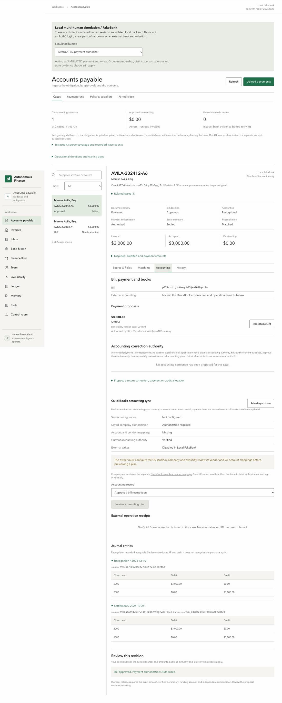

# Issue #107: APEX World 9 invoices through the AP system

Recorded on 2026-10-25 in the isolated local run `apex107-replay-20261025` (Convex 3460/3461, gateway 8847, UI 5197). FakeBank and simulated local identities only. Reproduce with [APEX-107-RUNBOOK.md](../../APEX-107-RUNBOOK.md). Full machine record: [run.json](run.json). Per-invoice inventory: [inventory.json](inventory.json).

**APEX is a synthetic company dataset authored for an accounting benchmark** (Mercor/Ramp APEX-Accounting, Harbor revision `1662b7e4c3b04b8717f2f723df823e7b6cbe2118`, CC BY 4.0). The company is Sterling, Marsh & Associates LLP, a fictional law firm. It is not a real customer's books and not Sweetgreen data.

## Versions and modes

| Item | Value |
| --- | --- |
| Code | Base `0dce4ed` (main) plus this PR's files, run before they were committed as `de8d32f`. The replay code is the same. The screenshot script then wrote PNG, later converted to 1100 px JPEG with `sips`. It now writes JPEG directly. |
| AP contract / legacy policy | `ap-evidence-v1` / `golden-state-ap-v1` |
| Business policy | `apex107-simulated-services-policy-v1` (SIMULATED) |
| Payment executor | `scoped-ap-v2` |
| Parser | Local poppler `pdftotext -bbox` 26.07.0, `apex-text-layer-v1`. Zero LlamaParse calls. |
| Models | None. `AGENT_LLM=off`. |
| Convex backend | `precompiled-2026-10-10-72ce13c`, fresh local deployment |
| Bank | FakeBank with explicitly simulated settlement |
| Identity | Six simulated local actors (AP field reviewer, supplier verifier, governor, matter owner, finance approver, payment authorizer) |
| Increase, QuickBooks, Auth0 | Not called. Blocked: needs JJ's sandbox credentials. |
| External IDs | None. No external provider was called. |

## Source files

| File | SHA-256 |
| --- | --- |
| `contract_attorney_invoices/Avila_AVILA-202412-A6.pdf` | `affe956edfd5d94a895ef35404bd149904199eeda2c593bd172c59bb13c9d9bc` |
| `contract_attorney_invoices/Avila_AVILA-202403-A1.pdf` | `c974e400eacb221d0a07fae70bd00a3a1f34574b9119c427fae3940f1025c4ff` |
| `operating_bank_statements/2024-04_operating_bank_statement.pdf` | `9a19d0cbb7cc596e9640e41b0798be0cd3af2102f054d83c2df0234dc6773027` |

Ledger, bank export, vendor master, GL detail and AP aging hashes are in `run.json` under `data.files`. All 21 invoice hashes are in `inventory.json`.

## Stage table

| Stage | Status | Evidence |
| --- | --- | --- |
| Inventory of all 21 invoices | passed | 21 parsed locally, 21 match one ledger row on number, date and total. 18 paid, each with exactly one bank candidate. 3 open. Matches the issue. |
| Case 1 original PDF → case | passed | Case `kd77s8m4wbstqzca03c56ny02h8gyj7q`. 12 fields with native word locations. Supplier, number, dates, terms, total, matter and description all match the ledger. |
| Case 1 field review | passed | SIMULATED AP reviewer, revision 1 and again on revision 2 |
| Case 1 payment refused before a bill | passed | HTTP 409 on the payment request |
| Missing service evidence identified | passed | Backend hold `business_policy_hold`: `missing_contract` and `missing_receipt` when only the invoice is cited |
| Simulated agreement and service acceptance | passed (simulated) | Two generated PDFs labeled SIMULATED, uploaded as revision 2 of the same case |
| Supplier master and policy | passed (simulated) | Backend refused the invoice as trusted-contact evidence (`independent_contact_required`). Contact, callback, beneficiary `apex107-simulated-avila-beneficiary` and policy are SIMULATED. |
| Bill approval and recognition | passed | Matter owner then finance (both SIMULATED). Bill `p573axbtcjxn0wwgdh85jen2098gzt2m`. Journal `s977bcrk0kw8bet2zxhktfv4958gzf6p` dated 2024-12-10: Dr 6000 $3,000.00, Cr 2000 $3,000.00. |
| Explicit payment authorization | passed | Version `qd7brvtjqjvb0wpnrpkr5hb75s8gz5rv`, command `p97595hbttppgbhm23c59gwhhd8gzqfd`, beneficiary `apex-v041:r1`. Stale snapshot refused. Zero transfers before the worker. |
| FakeBank payment | passed (local) | One transfer `transfer_95d01fdc1fdbec4999933e81`, one `createTransfer` call |
| Bank observation | passed (local) | Posted debit `txn_dd08aeb9b37d8b6ad8c2842d`, -$3,000.00. Settlement was simulated by the harness. |
| Reconciliation and journals | passed | Settlement journal `s97dadap94ww87ws3bj203a2n98gzvd9` dated 2026-10-25: Dr 2000, Cr 1000, $3,000.00, linked to the debit. Case is Settled / Matched, outstanding $0.00. Repeat worker passes posted 0. |
| Case 2 historical reconciliation | passed | 12 of 12 source checks. See below. |
| Case 2 no second payment | passed, with a gap | Case `kd74aqdbgd9y46dd9papakfrt18gyw6w`. Payment request refused (409), no bill, no journal, no FakeBank transfer. See the gap below. |
| Re-import without duplicates | passed | Same-key replays return the same cases. Case 2 under a new key and filename resolves to the same case. Case 1's invoice alone under a new key is refused (`explicit_revision_required`) because its current revision also carries the agreement and acceptance. Repeating the case 1 payment request returns the same version. A new payment key is refused. All counts unchanged: 2 cases, 1 bill, 1 payment version, 1 command, 2 journals, 1 posted bank row, 1 transfer. |
| Increase sandbox payment | blocked | Needs JJ's sandbox credentials |
| QuickBooks write and readback | blocked | Needs JJ's sandbox credentials. The UI shows external writes disabled for local FakeBank. |
| Real Auth0 login | blocked | Needs JJ's sandbox credentials |
| Practitioner review | not run | Not claimed |

## Case 2: historical source outcome

Kept separate from new observations. Nothing below was loaded into FakeBank or the ledger.

| Check | Result |
| --- | --- |
| One AP ledger row for `BILL-2024-00327` | yes |
| One bank row `OBT-000200` | yes |
| Ledger status Paid, outstanding 0 | yes |
| Bank row is an AP payment to Marcus Avila, Esq. | yes |
| Bank amount out, bill amount and amount paid are all $3,500.00 | yes |
| Bank date equals ledger payment date (2024-04-19) | yes |
| Bank reference is `CHK-2024327` | yes |
| Bank row offsets AP (2000) | yes |
| GL `JE-BILL-2024-00327` credits AP $3,500 | yes |
| GL `JE-OB-000200` debits AP and credits operating cash $3,500 | yes |
| Bill absent from the Dec 31, 2024 AP aging | yes |
| April 2024 statement prints `CHECK - MARCUS AVILA, ESQ.`, `CHK-2024327`, $3,500.00 | yes |

These are field matches inside one synthetic dataset. They are consistent with one payment of this bill. They do not independently prove the invoice-to-bank link. Amount and payee alone are ambiguous: `OBT-000691` (2024-10-25, `CHK-2024330`) is another $3,500 payment to the same supplier. The date and the reference pattern tell them apart. The statement shows this was a check, not ACH.

## What APEX does not provide

These invoices are for contract-attorney services. The AP system needs the following, and APEX has none of them for these suppliers:

1. A contract or rate agreement for the matter. Replaced by a SIMULATED agreement (rate $200.00/hour, 20 hours cap).
2. Service acceptance by a matter owner. Replaced by a SIMULATED acceptance of 15 hours.
3. Supplier bank details. The invoice says ACH details are "available upon request". Replaced by a SIMULATED beneficiary.
4. An independent supplier contact. Replaced by a SIMULATED contact and callback.
5. A firm AP approval policy for contract-attorney invoices. Replaced by a SIMULATED two-step policy.
6. A SKU. The invoices print none. The parser uses the printed Matter Reference as the service item and says so in the case's parse warnings.
7. W-9 and 1099 vendor tax documentation. Not modeled by this AP system.

APEX's own GL account for these bills is `5000 Contract Attorney Fees - Matter Direct`. In this repo's chart, 5000 is "Food, Beverage & Packaging". The simulated policy codes the expense to 6000 General & Administrative instead. The source account stays in the inventory.

## Gaps found

This is the original #107 run record. Issue #112 adds a durable historical-payment hold and stricter replay assertions; its separate validation is in [apex-112](../apex-112/README.md). The original IDs and screenshots below are preserved as the pre-fix evidence.

- **The product cannot record a historical payment.** Case 2 is protected today because the importer refuses to propose approval for a source-paid invoice and the backend refuses payment without an approved bill. The UI still offers "Propose business approval" on case 2. A person could approve it, and nothing in the system knows it was paid in 2024. A follow-up should add an explicit external or historical settlement record that blocks new payment.
- **HTTP intake overwrites provenance.** Every upload is labeled "User uploaded original". The dataset, license and revision live in this evidence and `run.json`, not on the source record.
- **Data quirks in APEX.** In all 21 PDFs the description text overlaps the Hours, Rate and Amount columns. The parser reads the numbers by right-edge alignment and records a warning. Only 6 of 21 invoices multiply exactly. All 12 Kao invoices print 24.2 h × $165.00 = $4,000.00 (actual $3,993.00) and all 3 Westfield invoices print 27.6 h × $145.00 = $4,000.00 (actual $4,002.00). The business policy's arithmetic check would hold those. Westfield's printed name lacks the "LLC" in the vendor master, so its supplier stays unbound.
- **The legacy Golden State policy still runs at intake.** It lists holds like `unknown_sku` and `missing_po` on case 1 revision 1 before the business path applies. They are not the business decision, but they show in the case history.
- **API error detail.** Refused payment requests return a generic `backend_rejected` (409). The specific reason is not shown to the caller.

## Screenshots

Captured at 1440 px width with the SIMULATED payment authorizer selected. Each stage has four tabs: source & fields, matching, accounting, history.

- `screens/01-approved-unpaid-*`: case 1 after bill approval, before payment request
- `screens/02-authorized-queued-*`: payment authorized and queued, no bank contact
- `screens/03-settled-matched-*`: settled, matched, both journals, outstanding $0.00
- `screens/04-case2-source-paid-*`: case 2 held, no bill or payment

