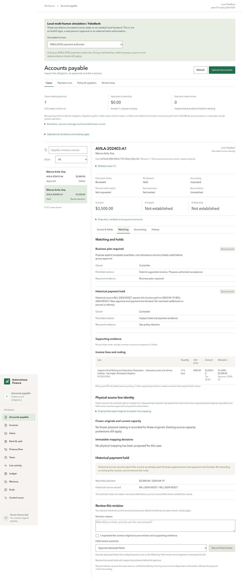
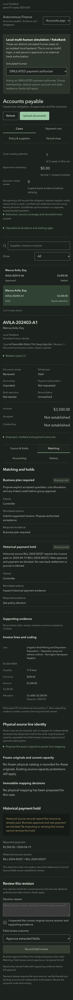

# Issue #112: historical-paid protection and reliable replay checks

Follow-up to PR #111. The implementation is based on `84369b7b35abde604c5c06a0b15ddf2b8d428b70`; the original [#107 evidence](../apex-107/README.md) remains intact. See [verification.json](verification.json) for the implementation commit, phase times, source hashes, explicit error codes and record counts.

## Changes verified

- A source-paid invoice retains a backend hold bound to supplier, invoice, amount, original PDF hash and historical source revision/hash. Field review, duplicate delivery and revised original bytes cannot clear it. The UI shows the hold and removes business-approval/payment preparation controls; the case is ineligible for a payment run.
- Business proposals and votes, legacy AP approval, legacy bill creation/approval, payment request/authorization and first dispatch enforce the hold. Legacy bills are checked by normalized supplier/invoice identity even if they predate case ingestion and have no case link. Unit tests exercise late evidence against pending approvals and queued but unsent payments.
- Historical statement evidence must contain exactly one check row with the matching reference, date, payee and debit. A reference on one row and the amount on another now fails, as do duplicate rows and amounts appearing only in the running balance.
- The missing-service-evidence phase requires HTTP 409, `business_policy_hold`, both `missing_contract` and `missing_receipt`, no bill and no journal. Transport errors and unrelated refusals fail the rehearsal.

## Local results

The original 21-invoice APEX inventory and all replay phases through `reimport` passed in a separate checkout with local Convex, FakeBank and simulated actors. After adding the legacy-API guards, `case2` and `reimport` passed again.

- The open $3,000 invoice reached **Settled / Matched**, with one FakeBank transfer and one posted bank debit.
- The historical $3,500 invoice passed **12/12** source checks. Business approval, payment and payment after re-import each returned `historical_payment_hold`; it has no new bill, journal or payment.
- Re-import left counts unchanged: **2 cases, 1 bill, 1 payment version, 1 command, 2 journals, 1 posted bank transaction, 1 FakeBank transfer and 1 createTransfer call**.
- `npm test -- --maxWorkers=4`: **1,963 passed, 4 skipped**, 205 files passed and one skipped. A prior unconstrained parallel run hit a 5-second timeout in `v12-external-settlement` and a race-order failure in `v14-tax-receipt-independent`. Those files passed alone (40 tests), then the complete suite passed with four workers. Their code was not changed.
- All three typechecks, console build and design check passed. The build reports the existing large-bundle warning. Rendered design review reports **0 failures**, one shell font-weight warning and one previously answered CSS finding.
- Browser checks covered Matching, Accounting and Payment runs at **390px and 1440px**, in **light and dark** modes: 12 combinations, no page overflow or browser exceptions, and no business-approval button for the held invoice. Screenshots were inspected for the changed controls.

No Increase, QuickBooks or real identity-provider operation was performed. Historical evidence imposes a restriction; it does not create a settlement or cash journal. This change has no hold-release workflow. Recovery of a bank operation already attempted remains available so an uncertain bank outcome is not discarded. GitHub CI was still disabled; these are local results.

## Screenshots

