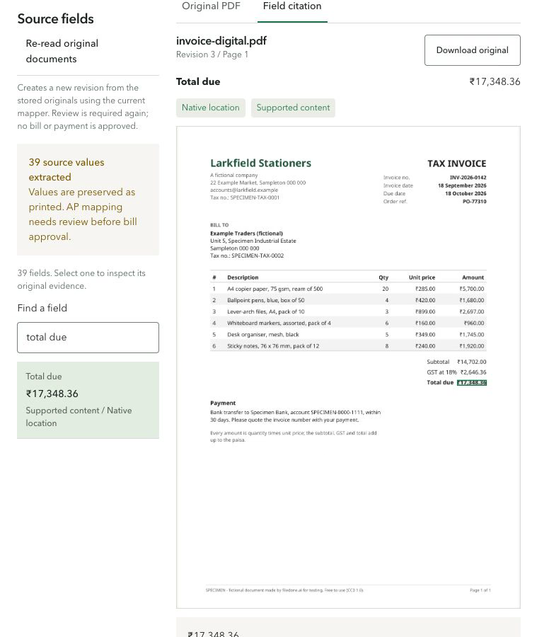

# Real PDF source fields in the invoice workspace

[Watch the 20-second screen walkthrough](pdf-source-fields.mp4).

Recorded on 2026-10-25 against the live local AP workspace. The screen shows the
Filedone fictional invoice INV-2026-0142 from Larkfield Stationers. Its original
PDF has SHA-256 `545655fc231453aaf2a6c60b44b3b137d506db0d1d79bff12eeef86044aedb86`.
See the [parser snapshot provenance](../../../../fixtures/ap-system/parser-contract-v1/README.md).

The original upload retained a real LlamaParse response but displayed zero fields
because the strict AP mapper rejected this invoice's layout and currency. After
the fix, **Re-read original documents** saved a new revision of the same case
using that retained response. Revision 3 displays 39 source values: nine headers
and all 30 cells from six line items. The recording selects the invoice number,
searches for the paper line item, and selects the printed total due; the native
source highlight follows each selection. The recording is sampled at five frames
per second and cropped to this invoice's source panel. Time between interactions
is shortened; it is not a measurement of provider latency or a fresh parser job.

The printed total remains **₹17,348.36**. Source readings are display-only:
the case still has no payable candidate, bill approval remains held, and payment
has not started. The processing stages distinguish successful PDF parsing from
AP mapping that needs review. This sample is not evidence of INR payable support.

Validation:

- 121 tests passed across ingestion, connected processing, and intake requests.
- Application and test typechecks passed; the console production build passed.
- Live UI re-read, field search, native highlights, and desktop/phone layout checked.
- The regression checks all nine headers and 30 table cells against the original,
  and verifies that missing geometry stays unresolved and cannot create a bill.
- `design:check` reports nine existing spacing errors in unchanged `proof.css`.
  Visual checks used the authenticated browser instead of the Puppeteer review
  script. Dark-mode emulation was unavailable in that browser session.
