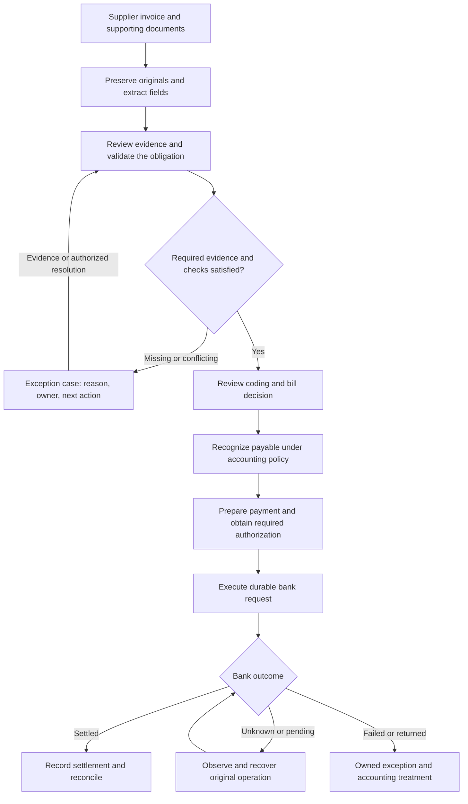

## Goal and product scope

Build an **evidence-backed Accounts Payable (AP) system** that turns supplier documents into reviewed accounting records, controlled payments and reconciled outcomes. An operator should be able to answer, for every obligation: **why do we owe this, how much, to whom, who approved it, what has happened, and what remains unresolved?**

The product covers document intake, supplier identification, procurement validation, coding, bill review, payable recognition, payment authorization/execution, exceptions, reconciliation and auditability. It uses purchasing and receiving evidence; it does not need to rebuild an entire procurement suite or ERP.

**The demo is a presentation of this system.** A small first dataset and staged delivery make the system verifiable; they do not limit the product to one invoice, one scripted happy path or a one-hour project. Prioritize correctness, evidence quality, useful automation and a polished experience. Model/API cost optimization is not a current selection criterion; consider latency where it affects interaction or throughput.

This is a roadmap, not a claim that all capabilities are implemented. Isolated parser/OCR diagnostics are explicitly recorded in section 4; they do not establish integrated AP or payment behavior. No implementation goal or business workflow was started for this planning update.

## 1. The complete business workflow

AP means money owed to suppliers. An invoice requests payment; it does not, by itself, prove receipt of goods, establish the correct accounting treatment or authorize a bank transfer.

| Stage | Question | Product output |
| --- | --- | --- |
| Receive | What arrived, from whom, and which version is it? | Immutable original document, provenance and case association. |
| Read | What does the document actually say? | Header/line fields tied to source evidence; uncertainty remains visible. |
| Validate and match | Is this our supplier and obligation? Do prices, quantities and receipt evidence agree? | Explicit match, discrepancy or missing-evidence result. |
| Code and review | What amount is accepted, how should it be classified, and who must decide? | Reviewable accounting allocations and a versioned business decision. |
| Recognize the payable | What should be recorded under our accounting policy? | Linked journal entry and outstanding obligation. |
| Prepare and authorize payment | What may be paid, to which verified destination, from which account and when? | An exact payment proposal and required authorization. |
| Execute and recover | What did the bank actually do? | Durable request, provider evidence and an explicit execution state. |
| Reconcile and resolve | Do business records, payment, bank activity and books agree? | Explained balances, linked evidence and resolved or owned exceptions. |

The diagram describes the target product, not today's wiring. Review loops must not recreate an already-posted bill or resend an unresolved payment. Recognition timing follows the accounting policy and underlying transaction, not simply the time someone clicks an approval button.

### Terms that must stay distinct

- **PO / purchase order:** what we agreed to buy. **Goods receipt / service acceptance:** what was delivered. **Invoice:** what the supplier asks us to pay. Three-way matching compares the relevant lines across these records.
- **Non-PO invoice:** a legitimate alternative workflow, such as a service bill supported by a contract and service acceptance. Missing a PO is not permission to skip validation.
- **Bill approval:** business review of the obligation and coding. **Payment authorization:** permission to release a specific amount to a specific beneficiary. Reviewing extracted fields is a third, separate decision.
- **Account coding / GL:** classification in the general ledger, including account, store/department/project and period. A purchase may be an expense, inventory, a fixed asset or a prepayment; AP is not synonymous with expense.
- **Credit note:** supplier evidence reducing an obligation, with explicit application to the original bill.
- **Reconciliation:** name what is being compared. Invoice/PO/receipt matching, supplier-statement reconciliation, bank-to-cash reconciliation and AP-subledger-to-GL reconciliation are different checks.

For a simplified $1,000 purchase that qualifies for immediate expensing, recognition increases expense and AP; settlement reduces AP and cash. Paying must not record the expense again. Other accounting treatments, tax and period-end accruals need explicit policies.

## 2. What we already have, and what is missing

**Review baseline:** main [`5e1126bd`](https://github.com/srivatsav-kannan/autonomous-finance/commit/5e1126bd20765bad45c22007bb1f67ef25e2375e), checked October 25, 2026. Earlier source inspection at `58f3be88` was checked against this revision; intervening changes did not alter the core AP/document/payment paths. Existing test/rehearsal evidence remains specific to its recorded revision, scope and provider.

| Area | Existing foundation to preserve | Remaining work |
| --- | --- | --- |
| Company data | [Sweetgreen profile](https://github.com/srivatsav-kannan/autonomous-finance/blob/5e1126bd20765bad45c22007bb1f67ef25e2375e/company/sweetgreen/profile.ts) and simulator provide calibrated, linked synthetic business data. | Original-document case packets with clear provenance and independently reviewed expected outcomes. Public company filings are not actual supplier books. |
| Document workspace | [Invoice workspace](https://github.com/srivatsav-kannan/autonomous-finance/blob/5e1126bd20765bad45c22007bb1f67ef25e2375e/docs/invoice-mvp/README.md) has source/history, proposals, decisions and per-customer net-invoiced totals. Upload identity and explicit revision protections already exist. | Direct PDF ingestion, LlamaParse and source-region highlights; a supplier AP contract. Customer totals must not be reinterpreted as AP balances or bank payments. |
| AP validation | [AP handler](https://github.com/srivatsav-kannan/autonomous-finance/blob/5e1126bd20765bad45c22007bb1f67ef25e2375e/src/agents/handlers/ap.ts) parses lines and checks duplicates, contract prices, receiving quantities, credits and stores. | First-class PO/receipt/invoice relationships and explicit unverified states. Missing delivery references or unknown SKUs must not silently count as a clean match. |
| Document-to-AP bridge | [Document contracts](https://github.com/srivatsav-kannan/autonomous-finance/blob/5e1126bd20765bad45c22007bb1f67ef25e2375e/src/invoice-mvp/contracts.ts) and the supplier AP/payment flow exist independently. | One case linking uploaded evidence to the actual bill, decisions, accounting and payment. The current invoice workspace does not itself post GL/bank transactions. |
| Accounting | [Bill acceptance](https://github.com/srivatsav-kannan/autonomous-finance/blob/5e1126bd20765bad45c22007bb1f67ef25e2375e/convex/demoPayments.ts) and [bank-observation posting](https://github.com/srivatsav-kannan/autonomous-finance/blob/5e1126bd20765bad45c22007bb1f67ef25e2375e/convex/lib/payments/applyObservation.ts) support basic AP recognition, credits, settlement and returns. | Reviewed line allocations, broader accounting treatments and controlled corrections. The scoped AP agent currently defaults coding to account 5000. |
| Authority and approval | Scoped roles, separate bill acceptance/payment authorization, versioned payment snapshots, reservations and stale-approval checks exist. | Configurable business approval prerequisites and supplier-change verification. Optional controller review is not a general enforced sequential approval engine. |
| Execution and recovery | [AP payment flow](https://github.com/srivatsav-kannan/autonomous-finance/blob/5e1126bd20765bad45c22007bb1f67ef25e2375e/docs/ap-demo/README.md) has saved requests/keys, fenced attempts, retries, polling, deduplicated effects and audited recovery. | Carry these guarantees through the connected supplier case, including ingestion, bill creation and future accounting sync. Do not rebuild the payment engine. |
| Bank integration | Local FakeBank flow, Increase adapter, contract tests and sandbox harness exist. | Recorded external Increase execution and webhook verification. The current guide marks these live checks **NOT_RUN**; local results do not establish them. |
| Operations and UI | Operator health, recovery actions, source/decision history and several finance views exist. | One understandable case workspace, complete cross-stage evidence links and measured full-flow outcomes. |
| Scheduling and ERP | Internal ledger and the scoped payment path are available. | Business payment scheduling/terms and a selected external accounting connector. Retry deadlines are not payment scheduling; internal posting is not ERP synchronization. |

See the [current rehearsal runbook](https://github.com/srivatsav-kannan/autonomous-finance/blob/5e1126bd20765bad45c22007bb1f67ef25e2375e/docs/DEMO.md) for existing demonstrations. Its seeded payment recovery and simulated-company scenarios are useful component evidence, not proof that an arbitrary uploaded PDF already completes this whole workflow. Coordinate with related extraction work in [#92](https://github.com/srivatsav-kannan/autonomous-finance/pull/92) rather than duplicating it.

### Verification status, evidence and ownership

Use these states separately: **implemented** means the component exists; **component-verified** requires a recorded test/rehearsal for that component; **integrated-verified** requires the same source case through the connected workflow; **external-verified** requires observed results from the named external provider. Configuration or successful authentication alone establishes none of the latter workflow claims. Every result must name its code revision, fixture/run, provider mode and evidence.

The following is a planning baseline, not a new test report. Existing component evidence must retain its original scope; the pending integrated work must not inherit a passing status from it. Owners below are logical workstream responsibilities, not newly assigned GitHub users.

| Capability | Verification status at this review | Evidence / limitation | Proposed owner | Next acceptance gate |
| --- | --- | --- | --- | --- |
| Company data and first packet | Simulator exists; reviewed original-document packet pending | [Profile](https://github.com/srivatsav-kannan/autonomous-finance/blob/5e1126bd20765bad45c22007bb1f67ef25e2375e/company/sweetgreen/profile.ts) and section 5; public calibration and synthetic transactions remain labeled separately | A — Evidence & Data; independent review coordinated by D | Freeze linked source files, provenance and independently reviewed expected outcomes for the exact case. |
| Document workspace and ingestion | Source/review foundation exists; LlamaParse-to-supplier-case flow pending | [Workspace guide](https://github.com/srivatsav-kannan/autonomous-finance/blob/5e1126bd20765bad45c22007bb1f67ef25e2375e/docs/invoice-mvp/README.md); customer totals do not establish AP effects | A + D — Experience & Assurance | Original PDF to reviewed supplier candidate, with accurate source highlights and complete pages. |
| Matching and document-to-AP bridge | AP checks exist; connected case pending | [AP handler](https://github.com/srivatsav-kannan/autonomous-finance/blob/5e1126bd20765bad45c22007bb1f67ef25e2375e/src/agents/handlers/ap.ts) and section 3; missing PO/receipt/SKU evidence must remain explicit | B — AP & Accounting | Create the intended bill once; clean and missing/conflicting-evidence cases produce the reviewed outcomes. |
| Coding, bill approval and accounting | Scoped component exists; broader policies/allocations pending | [Bill APIs](https://github.com/srivatsav-kannan/autonomous-finance/blob/5e1126bd20765bad45c22007bb1f67ef25e2375e/convex/demoPayments.ts); existing posting is not external ERP sync | B; presentation by D | Correct accounts, amounts and period; distinct field review and business approval; no duplicate recognition. |
| Payment authorization and recovery | Local component demonstration documented; uploaded-case integration pending | [AP operating guide](https://github.com/srivatsav-kannan/autonomous-finance/blob/5e1126bd20765bad45c22007bb1f67ef25e2375e/docs/ap-demo/README.md); preserve actual identity mode and run evidence | C — Payments & Integrations; independent verification coordinated by D | Same-case authorization and failure/recovery proof, with one intended transfer/debit/settlement effect in the specified test. |
| Increase payment execution | Adapter and contract-test foundation exists; external workflow not verified by this review | Sandbox authentication/resource readiness is separate from payment, polling and signed-webhook verification | C | Record actual sandbox command, transfer, bank transaction and reconciliation evidence; report webhook checks separately. |
| Case workspace and historical traceability | Separate views/history exist; complete cross-stage view pending | Sections 3 and 7; visually similar screens are not proof of shared case identity | D, using A/B/C contracts | Source, bill, decisions, payment, bank and journal drill-down all refer to the same case/run. |
| Scheduling and external ERP | Planned; internal ledger exists | No selected verified ERP connector is established here; business scheduling and ERP access are separate work | C, with B for accounting mappings | Independently verify scheduling, then the selected ERP's external IDs, retry behavior and reconciled results. |

**Master** owns shared interfaces, dependencies and integrated acceptance. D coordinates independent verification; an implementer should not be the sole reviewer of their own outcome. When a task completes, replace its pending status only with a linked verification artifact, including unresolved cases and what was not run.

## 3. Connect the system around an AP case

A **case** is the operational view of an obligation and its history. It should connect existing records, not force every concern into a new service or one giant database row.

| Record / relationship | Information that must survive end to end |
| --- | --- |
| Case and supplier | Company scope, stable case ID, verified supplier reference, owner, blockers and next action. Keep extracted supplier identity separate from the approved supplier master. |
| Source version and field evidence | Original bytes/reference, hash, MIME type, origin, version/revision link; raw/normalized values, page/text location, coordinate frame and native/derived/unresolved grounding provenance (section 4). |
| Bill candidate and bill revision | Supplier invoice number, currency, dates/terms, line quantities/units/prices, explicit tax/freight/discounts and totals; link to originating sources and later corrections. |
| Match and coding decision | Invoice/PO/receipt line links, compared values, tolerances, accounting allocations, policy version, rationale and review outcome. |
| Approval | Actor and authority, timestamp, prerequisites, exact reviewed revision/snapshot, decision and reason. |
| Payment allocation and command | Bills/credits and amounts being paid, verified beneficiary version, funding account, intended date, authorization and durable operation identity. Support one-to-many relationships as partial payments/batches are added. |
| Bank and accounting evidence | Transfer/transaction IDs, verified observations, journal IDs, external accounting IDs when applicable and reconciliation results. |

Preserve **invoiced, accepted, disputed, credited, instructed, settled and outstanding amounts separately**. An adjusted accepted amount must not overwrite what the supplier originally invoiced. Null/unknown is not zero. Use exact money representations, declared quantity units and documented rounding.

Keep document processing, business review, accounting posting, payment authorization, bank execution and reconciliation as separate status dimensions. “Bill accepted; payable posted; awaiting payment authorization” is a valid state. So is “bank settled; local posting needs repair.”

Before any payment submission attempt, a material change cancels the unsent command and requires a new approved snapshot. Once submission may have started, retain the original command and reservations until its bank outcome is resolved; new evidence or approval invalidation must not automatically make the obligation available for a replacement payment.

Agent responsibilities are reading, finding evidence, proposing coding/actions and explaining decisions. Deterministic backend controls enforce schemas, arithmetic, authority, approval prerequisites, scope, reservation and idempotency. Human decisions are explicit where policy requires them. An instruction embedded in a supplier document cannot grant permissions or update a beneficiary.

## 4. Document ingestion: use LlamaParse

**Selected first integration: LlamaParse**, behind a small replaceable server-side adapter. The diagnostics below used `agentic_plus`; pin and verify the intended parser/configuration version during implementation. It supplies parsed document content and layout; our extraction layer maps that output into the supplier-bill schema. Schema extraction does not itself validate a bill or authorize payment. No full LlamaIndex framework migration is required. [Getting started](https://developers.llamaindex.ai/llamaparse/parse/getting_started/)

- Preserve original files, raw parsing results, source versions, job IDs and parser/model/configuration versions. Resume known jobs after interruption.
- Request structured items and granular line/cell evidence explicitly; persist returned grounding files, page dimensions and coordinate conventions. Retain page/text/table evidence and available bounding boxes. Clicking a field should highlight its actual source; when coordinates are unavailable, show a truthful page/text citation. Validate alignment on rendered pages. [Layout and bounding boxes](https://developers.llamaindex.ai/llamaparse/parse/features/layout-and-bounding-boxes/)
- Validate fields and arithmetic; surface unreadable regions, missing pages and ambiguity for review. Parsing confidence and business validity remain separate.

### Verified grounding gap and bounded fallback

**Diagnostic evidence, October 25, 2026; application integration remains pending.** A clean digital invoice recovered 9/9 selected fields and 30/30 literal table cells with native cell boxes. A genuine archival scan recovered 9/9 selected fields and 2/2 cells after declared formatting normalization, but only 1/2 native cell boxes: description geometry was missing. These are tiny source-content checks, not a production accuracy benchmark or practitioner approval.

On the unchanged scan, one new `agentic_plus` parse added only `output_options.additional_outputs:["word_bbox"]` to the existing word/line/cell grounding configuration. The native description box remained absent. Raw OCR words had positions but read `Painting` as `Paintinq` and `11` as `I1`; strict alignment rejected both lines. Raw-word output must be requested when creating the job; retrieve it with `raw_words_content_metadata`. [Layout options](https://developers.llamaindex.ai/llamaparse/parse/features/layout-and-bounding-boxes/), [result retrieval](https://developers.llamaindex.ai/llamaparse/parse/guides/retrieving-results/).

Local Tesseract 5.5.2, English, on the original image supplied a viable fallback: PSM 3 failed one line; PSM 6 uniquely matched both lines, 13/13 tokens, with original-image overlay review. No fuzzy character/number correction or hand-written coordinates were used. The accepted regions are **derived OCR text-line regions**, not native cell boundaries. PSM 6 was tried after the initial failure on this one scan; it is not a universal mode recommendation. Other page text still had errors, so fallback OCR must not replace extracted invoice values wholesale.

**Adapter order and failure behavior**

1. Use valid native grounding with its actual granularity.
2. If absent, try unique exact alignment against raw OCR words, preserving token references and declared normalization.
3. If unresolved, try a bounded, recorded local OCR strategy. Accept derived regions only with unique text matching, valid geometry and consistent spatial order. Package/pin engine and language data in the target runtime; an installed binary on one developer machine is insufficient.
4. Otherwise retain `location_unresolved` and provide clearly labeled page/table context or review. The current scan's native body-row box covers only the amount; never use it to highlight the description. Preserve region lists for multiline text rather than inventing a full cell boundary.

**Contract and ownership:** Master freezes source hash/revision, page/frame, coordinate units/origin/orientation/transform, method (`native`, `raw_word_alignment`, `local_ocr_alignment`), provider/engine/model/config versions, token references, normalization and match status. A implements the adapter and fallback. B defines which evidence gaps hold a business step; missing coordinates must not silently become approval or an undocumented blanket rejection. D displays native/derived/unresolved states and version-correct highlights. Master assigns a separate verifier.

Acceptance evidence:

- [ ] Content fidelity and geometry coverage are measured separately, with unresolved cases retained.
- [ ] Matched text, valid coordinate mapping and source-version binding are checked against original pages; duplicate phrases, OCR mismatches, missing tokens and stale source versions are rejected.
- [ ] Rotation, page completeness and supported format cases are tested; parser/local OCR timeout or unavailable fallback leaves an explicit unresolved state.
- [ ] UI identifies derived regions and coarse context; no fabricated precise highlight or hidden value substitution.
- [ ] Reparse/restart/review cannot create a second bill or authorize payment; retain raw evidence and policy-defined review requirements.

The archival scan remains a private evaluation example subject to its source terms, not an automatically publishable Golden State fixture. Independent held-out cases and the linked Golden State packet remain required.

### Input formats and parsing routes

Route documents according to their actual format and content. The table below specifies planned ingestion behavior, not formats already verified in our application.

| Input format | Processing approach | Required verification and evidence |
| --- | --- | --- |
| **Digital PDF (native text)** | Extract the original text, tables and page locations through the document adapter. Use OCR where a page or embedded region requires it. | Preserve page order, table structure and field-to-source references. Confirm that highlights align with the correct original page and document version. |
| **Scanned PDF, JPEG and PNG** | Use OCR through LlamaParse to read image-based content. | Check critical fields against the original image, preserve page/image identity and orientation, and route unreadable or ambiguous content to review. OCR output alone is not evidence that a bill is valid. |
| **TIFF / TIF** | The provider supports TIFF input; use the image/OCR route. Application support remains subject to verification. | Explicitly test **multipage TIFF completeness**: every expected page/frame must be processed in the correct order, with no silently dropped or duplicated pages. Preserve page-level evidence and flag incomplete results. |
| **XML invoice, such as UBL** | Prefer direct structured-field parsing using the supported XML namespace, schema/version and invoice profile. OCR is unnecessary for the structured XML content. | Map supplier, invoice identifiers, currency, line items, taxes and totals into the same supplier-bill contract. Preserve the original XML and field references, such as element paths; do not invent PDF-style page coordinates. Unknown or unsupported structures require an explicit error or review path. |

LlamaParse documents OCR support for scanned PDFs and image inputs including JPEG, PNG and TIFF ([provider documentation](https://developers.llamaindex.ai/llamaparse/parse/features/ocr-and-languages/)). This does not establish multipage TIFF completeness in our integration. UBL provides structured XML business documents and schemas, including Invoice ([OASIS UBL specification](https://docs.oasis-open.org/ubl/os-UBL-2.3/UBL-2.3.html)); schema conformance does not establish the validity or authorization of the underlying purchase.

**Acceptance checks**

- [ ] Add representative fixtures for native PDF, scanned PDF, JPEG/PNG, multipage TIFF and a declared supported XML invoice profile. Record implemented, verified and unsupported formats separately.
- [ ] Verify page/frame completeness for multipage inputs against an independently known count, order and content. Missing pages or partial parsing results must remain visible and must not silently produce a complete bill candidate.
- [ ] Preserve original bytes, hashes, source versions, parsing method/configuration and field-level evidence across every route. Use page/region evidence for visual files and structural field references for XML.
- [ ] Equivalent supported inputs normalize into the same supplier-bill contract and pass the same arithmetic, duplicate, matching, approval and accounting checks. Parsing a structured invoice must not bypass AP controls.
- [ ] Report format-specific results and unresolved cases. Provider format support, successful file upload and successful end-to-end processing are separate claims.

Keep credentials server-side. The diagnostics above inform the first adapter and bounded fallback; they do not validate the planned linked Golden State case corpus. Quality and evidence fidelity remain the priority. Broader OCR comparisons can follow demonstrated gaps.

## 5. Data: reuse Golden State, complete the evidence packet, then expand

**First choice: reuse the existing Golden State Produce data and payment foundation.** Complete one reproducible, independently reviewed case packet before adding external datasets. This is the first integration milestone for the full AP system, not a one-invoice product boundary. No new ERP or ledger is required.

### What exists and what is missing

Baseline: the main revision recorded in section 2.

| Material | Reuse now | Still required |
| --- | --- | --- |
| Supplier, contract and policy | [Golden State profile](https://github.com/srivatsav-kannan/autonomous-finance/blob/5e1126bd20765bad45c22007bb1f67ef25e2375e/company/sweetgreen/profile.ts#L66): `golden-state-produce`, USD, Net 14, catalog prices and account 5000. [Memory seeds](https://github.com/srivatsav-kannan/autonomous-finance/blob/5e1126bd20765bad45c22007bb1f67ef25e2375e/src/memory/seed.ts#L49) provide effective-dated context and policies. | Freeze the applicable versions with the case. The supplier's simulated contact/bank data is not a verified real beneficiary. |
| Invoice PDF | Inspected local `var/ap-demo/ap-demo-cn-live-20261024/invoice.json`: **INV-1001, USD $662.90**, four lines, containing generated text. | Export a shared fixture and render a PDF from the same frozen facts. Retain the text and provenance; label the PDF **synthetic rendered document**, not a real supplier original. |
| Purchase order | Existing contract prices support contract-price validation. | A first-class PO and PO-line chain are missing. Author an explicitly synthetic PO with supplier/store, dates, currency, quantities, units, prices and line IDs when adding three-way matching. Until then, call the check **contract/receipt validation**. |
| Receipt | [The generator](https://github.com/srivatsav-kannan/autonomous-finance/blob/5e1126bd20765bad45c22007bb1f67ef25e2375e/src/world/generate.ts#L292) creates receiving events with delivery ID, date, store, supplier and SKU quantities. | Locate/export the event for this exact invoice/run and render its receipt if needed. Its inclusion in the local invoice artifact is not established. If unavailable, keep it missing or regenerate a complete consistent case; do not backfill a fictional historical receipt to force a match. |
| Changes and exceptions | Linked price/quantity discrepancies, duplicate documents and later credit memos can be generated. | Export selected related records with arrival/effective times and revision links. Preserve the original document and later resolution separately. |
| Expected outcomes | Generator-authored errors and economic obligations provide regression truth independent of agent decisions. | Independently review the expected fields, relationships, dispositions and accounting/payment effects. Generated truth is not practitioner-validated ground truth. |

### Shared packet and human review

Publish the packet in the agreed repository fixture location so teammates do not depend on an unshared local `var/` directory. Include source files, frozen business context and a manifest recording generator revision/seed/configuration, case/document IDs, source hashes/versions, document dates and arrival order, and supplier/invoice/PO-line/delivery/credit relationships. Distinguish exported records from newly authored synthetic documents.

Keep **expected results** separate from **actual execution results**. Policies and supporting documents are agent inputs; answer keys and evaluator privileges are not.

A reviewer independent of the agent's answer should confirm:

- **Fields and relationships:** extracted headers/lines/totals and supporting source references; correct supplier, contract/PO/receipt/credit links; duplicate versus revised versus separate obligations.
- **Decisions at each stage:** hold, ask, reject or advance using only evidence available then; reason, responsible owner, allowed resolution and required authority. Later receipts or credits change the permitted next action without rewriting earlier history.
- **Amounts and accounting:** original, accepted, disputed, credited and outstanding amounts; accounts, period and journal effects at recognition, adjustment and settlement. Review automatic short-pay assumptions against the explicit company policy in section 9.
- **Payment and retry effects:** whether preparation/authorization is allowed, approved amount and trusted destination source, and expected effects under reimport, retry and recovery. A correct hold is a valid expected result.

Record reviewer identity/qualification, review date, policy/label version, rationale and unresolved questions. Distinguish an internal consistency review from an AP practitioner's business review. Labels remain **draft / policy-derived** until the relevant review is completed; reviewing a test answer does not authorize a runtime payment. Known fixtures establish integration/regression behavior, not unseen extraction accuracy.

### Connect to the existing workflow

1. **PDF → reviewed candidate:** preserve the source in the document workspace; run LlamaParse as described in section 4; retain raw output, source version and field/page evidence. Normalize into a supplier-bill candidate using exact money and explicit units.
2. **Candidate → business validation:** resolve the trusted supplier and load the frozen contract/PO, matching receipt and company policy. Reuse/extend existing AP checks; keep uncertain identity, missing evidence and discrepancies explicit. Parsed bank instructions cannot replace the approved beneficiary.
3. **Review → actual AP bill:** bridge the reviewed candidate to the existing scoped bill API. Persist case/source-version/review-to-bill links and make reimport/retry idempotent. The document workspace's customer net-invoiced totals are not AP balances or the accounting handoff.
4. **Bill → recognition and payment authorization:** use the existing bill acceptance/accounting path under the applicable policy and authority, then prepare the existing payment proposal and obtain separate authorization. Document review, bill acceptance and payment approval remain distinct. Source changes must re-evaluate affected decisions without overwriting posted obligations or reusing stale approval.
5. **Payment → bank evidence and reconciliation:** reuse the durable payment/recovery engine and configured sandbox beneficiary. Capture actual bill, approval, bank and journal IDs under the same case, and return status/evidence/blockers to its workspace. Label FakeBank versus external sandbox results; historical results from another run do not prove this PDF completed the flow.

Implementation touchpoints: [document contracts](https://github.com/srivatsav-kannan/autonomous-finance/blob/5e1126bd20765bad45c22007bb1f67ef25e2375e/src/invoice-mvp/contracts.ts), [AP checks](https://github.com/srivatsav-kannan/autonomous-finance/blob/5e1126bd20765bad45c22007bb1f67ef25e2375e/src/agents/handlers/ap.ts), [scoped bill APIs](https://github.com/srivatsav-kannan/autonomous-finance/blob/5e1126bd20765bad45c22007bb1f67ef25e2375e/convex/demoPayments.ts) and [payment operating guide](https://github.com/srivatsav-kannan/autonomous-finance/blob/5e1126bd20765bad45c22007bb1f67ef25e2375e/docs/ap-demo/README.md). These components currently exist separately; the connection above is work to complete.

First-packet acceptance:
- [ ] Another teammate can reproduce the packet from its recorded source/configuration.
- [ ] Source relationships, synthetic provenance and missing evidence are explicit; expected outcomes have recorded independent review and are hidden from agents.
- [ ] The uploaded PDF reaches a reviewed bill through the real bridge, with traceable accounting/payment outcomes for the same case.
- [ ] Missing/conflicting evidence follows the reviewed policy; source changes and repeated ingestion cannot bypass review or duplicate effects.

### Later data expansion

Add suppliers/layouts, native PDFs and scans, multi-page lines, duplicates/revisions, partial delivery, credits, non-PO bills and unsupported cases. Keep a held-out supplier/layout subset and record provenance/permission for every external document.

[OASIS UBL examples](https://docs.oasis-open.org/ubl/cd-UBL-1.0/) are a possible later external document/relationship case, with order-change context and applicable notices retained; they are illustrative transactions without independently adjudicated AP outcomes. [BPI Challenge 2019](https://figshare.com/articles/dataset/BPI_Challenge_2019/12715853) can inform later evaluation of real anonymized process sequences, but supplies neither original invoice PDFs nor proof that historical actions were correct. Neither is a prerequisite for Golden State.

[SEC filings](https://www.sec.gov/search-filings/edgar-application-programming-interfaces) can calibrate company-level assumptions; they do not provide the supplier invoice/receipt/payment chain. External benchmarks are later coverage candidates, with task fit and usage terms checked before adoption: [AccountingBench](https://x.com/yunyu_l/status/1946261507723173935), [APEX-Accounting](https://huggingface.co/datasets/mercor/apex-accounting), [Finance Agent Benchmark](https://huggingface.co/datasets/vals-ai/finance_agent_benchmark), [DABstep](https://huggingface.co/datasets/adyen/DABstep), [BenchRec](https://www.kaggle.com/datasets/benchmarkteam/benchrec-real-world-cash-reconciliation-dataset), and [Invoice Sandbox](https://github.com/ciru-ai/invoice-sandbox-benchmark). Their task scores must not be presented as full AP-system correctness.

## 6. Build sequence and completion gates

These are implementation phases, not a forced three-person split or a promise to finish the full system in an hour. Reuse the current foundations. Each phase should leave usable, testable behavior.

| Phase | Build / extend | Gate before calling it complete |
| --- | --- | --- |
| **A. Case contract and evidence foundation** | Define shared records/statuses and the accounting-policy boundary; freeze the first case packet; implement LlamaParse and field review. | Original PDF to reviewed supplier-bill candidate with stable source links. Missing/uncertain fields remain visible; restart/reimport preserves identity and history. |
| **B. Business validation and exceptions** | Connect candidate to existing AP APIs. Add explicit PO/receipt matching, non-PO evidence, duplicate/revision treatment, credits and owned exception resolution. | A clean case advances; missing/conflicting evidence is held with reason, owner and permitted resolution. Corrections retain history and cannot create another obligation accidentally. |
| **C. Coding, approvals and accounting** | Reviewable account/location allocations; configurable required business reviews; exact revision binding; appropriate payable posting and controlled adjustments. | A reviewed bill posts once with the expected balanced entries. Out-of-order, self-approval and stale decisions are rejected where policy requires separation. Posting does not grant payment authorization. |
| **D. Payment operations and reconciliation** | Connect the same case to the existing payment engine. Add explicit terms/date handling, outstanding-balance/credit allocations and supplier destination controls. Verify the Increase sandbox independently. | The same source case reaches authorized payment, verified bank evidence and linked accounting/reconciliation. Local and external results are separately labeled; unresolved transfers remain visible. |
| **E. Complete the operating experience** | Case workspace, evidence highlights, exception/approval queues, audit timeline and cross-stage operator diagnostics. Extend crash/retry verification across connected steps. | A user can explain every amount, decision, blocker and next action. Recovery preserves original operations and creates no duplicate bill/payment/journal effects in the specified tests. |
| **F. Broaden coverage and integrations** | More real-world documents, business policies, accounting treatments, payment operations, one selected ERP connector and held-out evaluations. | Each new capability has explicit supported scope, fixtures and failure tests; ERP mappings, sync conflicts and source-of-truth boundaries are verified. |

The UX should be designed alongside these phases, rather than deferred until everything else is built. Wider event simulation and large scenario generation come after the initial case contract and connected path.

**Domain extensions within the full roadmap:** partial receipts/invoices/payments; credit application and returns; configurable approval thresholds, groups, delegation and escalation; supplier onboarding and verified bank-detail changes; payment runs/scheduling; supplier-statement and AP-to-GL reconciliation; period-end accruals and controlled reopening/adjustments; then broader tax, currency and account support. Select policy and acceptance tests before enabling each one. Received-but-not-invoiced goods or disputed amounts must not disappear just because they are outside an “approved invoices” queue.

For an external ERP, choose which system owns supplier master data, bills, GL and payment state; define external IDs, idempotent writes, sync status and conflict handling. Odoo/ERPNext or other accounting systems can serve a later integration target. They are not prerequisites for validating the current internal ledger. The bank sandbox is where we verify external payment behavior; it is a different responsibility from document parsing or ERP sync.

**Immediate next work**

- [ ] Agree and document the shared supplier-case contract, status dimensions and first supported accounting/approval policy.
- [ ] Export the smallest reproducible case packet, preserving the distinction between synthetic text, rendered PDF and externally sourced originals.
- [ ] Add LlamaParse-backed ingestion, bounded grounding fallback and evidence review; keep native, derived and unresolved locations distinct.
- [ ] Connect that reviewed candidate to the actual AP bill path; then carry the same case identity through approvals, existing payment execution and reconciliation.
- [ ] Capture the first connected verification report before expanding suppliers, exceptions and integrations.

## 7. User experience and observability

The primary workspace should show the **original document**, **extracted/reviewed facts**, **business evidence**, **current decision** and **next permitted action**. Source highlights are functional evidence, not decorative overlays.

- Open a case from an invoice, approval queue or exception queue without losing context.
- Clicking an amount or decision opens the exact source version or supporting record.
- Show accepted/disputed/outstanding amounts and specific status dimensions, not one ambiguous green “complete” label.
- Each exception states what happened, what is missing, its owner and what resolves it.
- The timeline links document changes, agent proposals, human decisions, policy versions, commands, bank observations and journal effects.
- Keep technical diagnostics available through progressive detail: correlated case/source/bill/command/transaction/journal IDs, attempts, retry deadlines and errors. Do not expose credentials or sensitive request payloads in the user-facing timeline.

Measure document-to-review and review-to-post time, human waiting time, exception age, evidence coverage, unresolved payment age, recovery time and duplicate effects. Distinguish worker liveness from actual progress. Report targets separately from measurements; a healthy process alone does not prove a completed business case.

### Accounting vocabulary in the demo

Include the following terms in the walkthrough, tied to visible business records and actions. Combine related terms into scenes rather than adding a separate glossary tour. This is a presentation requirement for the full AP roadmap; it does not mark unfinished integrations as implemented.

| Term | What the walkthrough should show and explain |
| --- | --- |
| **System of record** | Identify the authoritative source for each fact: the approved supplier master for the payment destination, receipt/service acceptance for delivery, the ledger for posted accounting, and verified bank records for bank execution. The invoice is evidence of the supplier's claim; it does not override every other source. |
| **Subledger** | Open supplier-level bills, credits, payment allocations and outstanding balances. Explain that these AP details must reconcile to the corresponding AP control account in the general ledger. A list of invoices alone does not prove this reconciliation. |
| **Chart of accounts** | Show the accounts available for coding and the selected account for this bill. Explain why the purchase belongs there; an invoice is not necessarily an immediate expense. |
| **Journal entry** | Open a dated posting with accounts, debit/credit amounts, business reason and links to the originating bill/decision. A journal entry records financial effects; it is not necessarily a cash movement. |
| **Double-entry bookkeeping** | Highlight equal total debits and credits across the posting. For a purchase qualifying for immediate expensing, show debit expense / credit AP on recognition, then debit AP / credit cash on settlement. Do not expense it again when paying. Entries can contain more than two lines; balance alone does not prove the accounts, amounts or period are correct. |
| **General ledger** | Follow the journal into the affected account balances. Clearly identify our internal ledger; do not imply an external ERP has received a posting without connector evidence. |
| **Materiality** | Explain the business significance of a discrepancy using the company's explicit policy and context. Show the operational matching tolerance actually applied. A matching tolerance is one specific rule, not a substitute for financial-statement or audit materiality; small amounts do not override fraud or authorization controls. |
| **Internal controls** | Demonstrate an actual enforced check, such as blocking duplicate obligations, unverified beneficiary changes or payment without required approval. Show the reason and allowed next action, rather than only describing a prompt instruction. |
| **Segregation of duties** | Show distinct requester and authorized approver identities, and evidence that a prohibited self-approval is rejected by the backend. Describe the separation required for this workflow without claiming every action requires two people. |
| **Controller** | Introduce the role responsible for accounting accuracy, exception review and close oversight. Show its authority and limits. Distinguish the software controller agent from an accountable human Controller, and keep bill review separate from payment authorization. |
| **Reconciliation** | Name the records being compared. Show bill/payment/bank links and the accounting effect; separately show AP-subledger-to-GL reconciliation when implemented. A bank status label or equal journal totals alone is not reconciliation. |
| **Period close** | Show the period, outstanding blockers, required reviews/signatures and closed status. Claim a locked period only with evidence that prohibited postings are rejected and corrections follow the declared policy. A successful scoped demo close does not establish a complete enterprise month-end close. Properly recognized and reconciled unpaid AP may carry into the next period; the current scoped demo's all-bills-paid gate is specific to that scenario. |
| **Audit trail** | Trace a selected decision from the original source/version through the applied policy, actor, approval, payment operation and journal. Identify missing links honestly; a later explanation generated from current state is not by itself a historical audit trail. |

Suggested story order: source authority and AP detail → coding and recognition → discrepancy review and control ownership → independent payment authorization → crash/recovery and reconciliation → close and historical traceability. The opening may still use the existing recovery moment; this order defines the accounting explanation, not a mandatory replacement of the rehearsal script.

Presentation acceptance:
- [ ] All 13 terms are used accurately in narration and anchored to a relevant screen, record or explicitly identified planned capability.
- [ ] Related views refer to the same case/run and explain the same amounts; distinguish separate component demonstrations while the bridge is incomplete.
- [ ] Highlight source fields, journal lines, identities and reconciliation links when naming them.
- [ ] Distinguish original documents, synthetic company data, simulated people/FakeBank and independently verified external integrations.
- [ ] Show implemented controls and recorded verification evidence; label unimplemented behavior as planned.

### Required same-case demo and accurate claims

The full integrated walkthrough must use one Golden State case from source to outcome. Until the bridge is verified, label separate component demonstrations explicitly; do not imply that a displayed source PDF caused a payment from another seeded run.

| Scene | Visible evidence and interaction | What it establishes |
| --- | --- | --- |
| 1. Start from the source | Open the original invoice, show its provenance, and click supplier/amount/line fields to reveal the correct source version and region. Open the linked PO/contract and receipt. | The proposed facts have inspectable sources; any synthetic render and missing evidence are disclosed. |
| 2. Show a meaningful exception | Use a separately versioned fixture with a quantity discrepancy or missing receipt. Display the compared values, applied rule, blocking reason, owner and permitted next action. | The system can hold and route an unresolved case. It does not invent a receipt, automatically short-pay, or treat a review note as sent vendor communication. |
| 3. Separate the approvals | Show field review, business bill approval and payment authorization as distinct decisions. Pause at “bill approved; payment not authorized.” Show the approved amount, trusted destination and funding account before release. | Approving the document/bill does not itself grant payment authority. A prohibited unauthorized or stale approval is actually rejected by the backend. |
| 4. Interrupt and recover | After bank acceptance but before the worker records completion, interrupt the worker. Show the unresolved state, recovery attempt, original command/key and original provider transfer. | Recovery retains the authorized operation. Show observed counts and identities for the specified fault; do not promise exactly-once network execution. |
| 5. Reconcile and trace backward | Open the verified bank transaction and settlement journal, then navigate back to the payment approval, bill and original evidence. Distinguish the bill-recognition entry from the settlement entry. | The same case has an explained accounting/payment outcome; payment did not recognize the purchase cost again. |

Add a short duplicate demonstration: submit the same invoice again, including a renamed copy where supported. Show the new delivery/source record associated with the existing obligation, with no second bill, payment or accounting effect. Keep the distinct test of unrelated documents sharing a filename.

**Presentation and runbook wording**

- Describe the current implementation as **existing AP, document and recovery components being connected and verified** until the full source-to-outcome acceptance passes. The historical runbook's phrase “AP is complete” must not serve as evidence of the unfinished bridge.
- Replace an unqualified “exactly-once payment” pitch with: **“In this tested failure, recovery reused the authorized operation and produced one intended transfer, one posted bank debit and one settlement journal effect.”** The initial bill-recognition entry and other legitimate entries are separate.
- Label data provenance, provider mode and integration status on the relevant screens/proof card: synthetic documents/company, local FakeBank or external Increase sandbox, internal ledger, and ERP sync status. Use **not connected / not run** where appropriate.
- Show source fields, actors, business reasons and outcomes by default. Keep command IDs, attempts and diagnostic details available for the recovery proof and technical questions.
- Preserve a clean baseline and a reproducible exception variant. Record any later correction or receipt as new evidence rather than silently editing historical facts to make a case pass.
- Keep the published capability matrix and actual runbook synchronized with measured results. This issue specifies the wording and acceptance requirement; it does not itself change the historical repository runbook or rerun its tests.

Additional demo acceptance:
- [ ] All five scenes are demonstrated on one linked case, or visibly labeled as separate component demonstrations until integration is complete.
- [ ] The duplicate/resend interaction produces no second obligation or payment.
- [ ] A reviewer can follow both directions of the source → bill → approval → command → bank → journal chain.
- [ ] The proof card records code/data/policy revisions, case/run IDs, provider and identity modes, fault point, observed counts and remaining gaps.
- [ ] Current narration and runbook avoid claims stronger than the linked evidence.

## 8. Reliability and evaluation: prove the actual outcomes

Extend existing controls and recovery tests. Use a frozen case set with expected outcomes and record code, data, parser/model, policy and provider versions. Unsupported or unresolved cases stay in the denominator.

| Test family | Required observable result |
| --- | --- |
| File identity and revision | Same-named different files remain distinct; repeated delivery does not create a duplicate payable; explicit revisions preserve previous evidence and decisions. |
| Parsing and evidence | Critical headers and lines are correct and supported, or visibly unresolved. Test native/derived location provenance, mismatched or duplicate text, fallback failure, rotation and source revisions. Failed/missing pages cannot silently produce a complete candidate. |
| Matching and non-PO handling | Missing receipt, unknown SKU/unit and price/quantity differences cannot be labeled clean. Approved alternative evidence is distinguishable from three-way matching. |
| Coding and accounting | Expected allocations and balanced entries; bill recognition and settlement have different effects. Credits and corrections are applied once with traceable treatment. |
| Authorization | Unmet prerequisites, prohibited self-approval, stale revisions and unverified beneficiary changes are blocked by the backend. Changed material scope requires renewed review. |
| Ingestion / bill retry | Worker restart and repeated confirmation preserve source history and produce the intended bill/posting once. |
| Bank accepted, response lost | Recover using the original request and operation identity. No new key or replacement transfer merely because the outcome is unknown. |
| Concurrent or stale worker | Expired workers cannot commit over current ownership; concurrency does not create a second economic effect. |
| Settlement / posting interruption | If the bank settled but local posting failed, repair/retry posting without dispatching payment again. Duplicate or delayed observations do not duplicate journal effects. |
| Rejection, return and unmatched activity | Preserve original and corrective evidence; expose unresolved balances and block inappropriate completion/close. |
| External service failure | Rate limits, outages and invalid credentials preserve state, use bounded retries or explicit operator action, and never imply success. Add the same tests for ERP sync when introduced. |
| End-to-end case | Trace original source through review, authorization, bank evidence and accounting. Report local simulator, contract-test and external sandbox results separately. |

Do not summarize reliability as an unqualified “exactly once” claim. Show the verified invariants, such as one authorized transfer, one settlement effect and no duplicate journal posting for the tested failure. A correct hold is an intended business outcome; measure false holds as well as unsafe approvals.

Layer evaluations into extraction/evidence, business decisions, accounting, execution/recovery and full-case outcomes. Publish sample counts, manual-review coverage, errors and unresolved cases alongside accuracy. Broader benchmark results supplement these tests; vendor claims, simulated results and known-fixture scores do not substitute for them.

## 9. Domain input and related work

The supplied [Ramp](https://www.youtube.com/watch?v=2SPwBRvNz8M), [Jason/Makershub](https://www.youtube.com/watch?v=AsCJ-pn_AKA) and [KPMG](https://www.youtube.com/watch?v=fJAM5sxZI4U) transcripts motivate the core requirements: line-level evidence, PO/receipt checks, accounting allocations, separate approvals, exceptions and bottleneck visibility. Treat their cost savings, automation rates and fraud claims as source claims, not measured results for this product.

### Public AP policies and executable company rules

Use the following published policies as domain references for **Phases B and C**. Adopting their decision logic does not require integrating new software. Define our own versioned company policy, retaining our roles and explicitly chosen thresholds; do not silently import university-specific limits, staffing structures or payment schedules.

**Primary sources**

- [Virginia Tech — Accounts Payable Procedure 20310f: Payment Tolerance](https://www.controller.vt.edu/accountspayable/20310f.html). Invoice/PO price differences beyond its tolerance are routed to Procurement or the responsible department for written approval. The decision is retained with the invoice; unaccepted differences require a corrected invoice or credit memo through the responsible owner. Transferable requirement: every discrepancy needs an owner, permitted resolutions and retained evidence.
- [Upper Iowa University — BO-214: Accounts Payable Payment Policy, effective May 29, 2024](https://uiu.edu/wp-content/uploads/BO-214-Accounts-Payable-Payment-Policy-5-29-24.pdf). Incomplete or inaccurate payment requests return to the responsible budget officer; vendor bank-detail changes are checked through a phone number previously on file; payment preparation and approval are separated; supporting records are retained. Transferable requirements: owned correction requests, independent vendor verification, segregation of duties and supporting documentation. Its specific staffing and scheduling rules are not automatically our policy.

**Current behavior to correct**

At the reviewed main revision, [the controller handler](https://github.com/srivatsav-kannan/autonomous-finance/blob/5e1126bd20765bad45c22007bb1f67ef25e2375e/src/agents/handlers/controller.ts#L11) can automatically approve reduced amounts for price/quantity exceptions. Computing a proposed adjustment does not itself confer authority to short-pay. Require either an explicit company rule authorizing the adjustment under defined conditions or a recorded decision from an authorized owner. Preserve the original invoiced amount, proposed/accepted adjustment and resolution evidence separately.

The [same handler's dispute-note logic](https://github.com/srivatsav-kannan/autonomous-finance/blob/5e1126bd20765bad45c22007bb1f67ef25e2375e/src/agents/handlers/controller.ts) writes “Vendor notified.” A memory note does not establish that communication was sent, delivered or acknowledged. Record the actual communication state and its evidence; simulated communications and callback results must remain identifiable as simulations.

**Proposed company decision table**

| Condition | Disposition and responsible owner | Permitted resolution / required evidence |
| --- | --- | --- |
| Price above the applicable contract/PO tolerance | Hold for the purchasing owner or controller with the required authority. | Documented approval of the variance, or a corrected invoice/credit memo; retain compared lines and the authorization. |
| Short shipment or missing receipt | Hold the unresolved case or disputed portion under an explicit policy; assign the receiving owner. | Receipt/service-acceptance evidence, a documented exception or an authorized adjustment. Silence and the agent's own calculation do not establish acceptance. Partial payment requires supported allocation and separate payment authorization. |
| Incomplete or inaccurate invoice/coding information | Return to the responsible AP/business owner; show the missing information. | Corrected fields or supporting documents, followed by revalidation. Preserve source and decision history. |
| Proposed vendor bank-detail change | Hold the change; assign the vendor-verification owner and an independent authorized approver. | Verification through an independently held contact, recorded result and required approval. The incoming request cannot supply its own trusted verification channel. |

Each implemented rule must identify its condition, disposition, owner, permitted actions, required evidence and authority to release the hold. Bill resolution remains distinct from authorization to release a payment.

Acceptance evidence:
- [ ] Unresolved cases remain held; only an authorized resolution or applicable explicit policy permits progression.
- [ ] Decisions retain the policy version, actor, timestamp, source versions and supporting approval/correction evidence.
- [ ] Short-pay cannot occur solely because the agent recommends a lower amount; credits and adjustments retain their accounting treatment and are applied once.
- [ ] Notification and vendor-verification claims match recorded actions and results.
- [ ] Expected outcomes are labeled policy-derived until independently reviewed; citing a public policy is not practitioner validation of our implementation.

Related: [#92 extraction](https://github.com/srivatsav-kannan/autonomous-finance/pull/92), [#66 evaluation protocol](https://github.com/srivatsav-kannan/autonomous-finance/issues/66), [#65 identity/payment gate](https://github.com/srivatsav-kannan/autonomous-finance/issues/65), [AP architecture and operating guide](https://github.com/srivatsav-kannan/autonomous-finance/blob/5e1126bd20765bad45c22007bb1f67ef25e2375e/docs/ap-demo/README.md), [recovery verification](https://github.com/srivatsav-kannan/autonomous-finance/blob/5e1126bd20765bad45c22007bb1f67ef25e2375e/docs/ap-demo/recovery-verification.md), and [invoice workspace](https://github.com/srivatsav-kannan/autonomous-finance/blob/5e1126bd20765bad45c22007bb1f67ef25e2375e/docs/invoice-mvp/README.md).

The first connected case completes an integration milestone, not this roadmap. Before closing this issue, publish a supported-capability matrix covering the promised PO/non-PO, exception, approval, accounting, payment and reconciliation paths, with passing acceptance evidence. Resolve remaining roadmap items as implemented or explicitly moved to linked follow-up issues through an agreed scope decision.

The demo should exercise the same product path and show its evidence; it should not seed unrelated records to imply a connection that does not exist.
