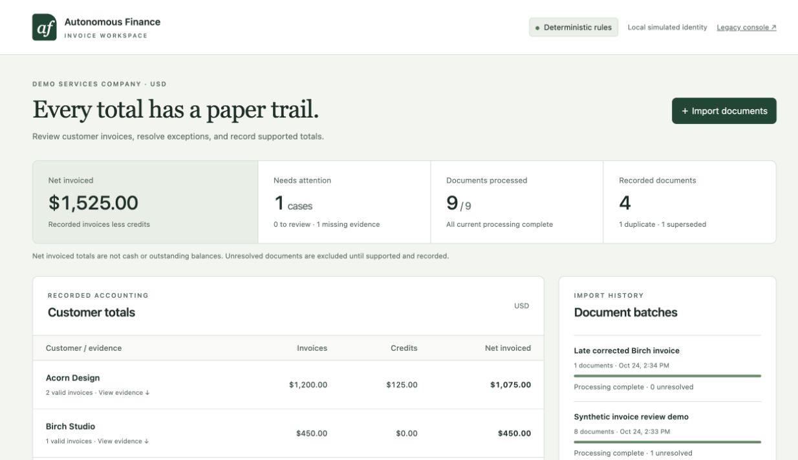

# Integrated acceptance evidence

## Updated workbench integration — 2026-10-24

Application source: `09336cf4d5c1f6ba11d01c3a40b27d090363b2e8`. This merges the committed workbench through `5b9ef92` into the invoice branch and embeds Invoices alongside all nine simulation views. Invoice totals remain scoped to their gateway workspace; simulation scenario selection, bank balances and WebMCP actions remain scoped to the simulation. The invoice route works even without a configured simulation backend.

Fresh deterministic workspace `invoice-ui-integration-20261024`, through a separate gateway on :8812 and browser on `http://localhost:5182`, passed empty-state rendering, eight-source demo import, exact disputed-invoice approval, replay without a second receipt, reload persistence, late correction and source drill-down. Final totals were Acorn $1,075 and Birch $450: four recorded documents, one duplicate, one superseded version and one unresolved unfamiliar source. The synthetic operator decision is explicitly labeled as a UI acceptance test. No paid inference, benchmark rerun, payment or general-ledger posting was performed.

The shared drawer traps focus and restores the source button after Escape; opening it by URL and closing after reload restores the invoice heading. Browser back/forward switches views correctly. All ten navigation destinations load; the simulation Scenario selector is absent on Invoices and the simulation WebMCP tools are unregistered there. The existing simulation backend on :3220 and its human gateway on :8787 stopped during visual verification and were restarted with the same stored database/functions. Bank & cash recovered its $252,289.30 simulated book balance. No teammate source files or deployed functions were changed by that restart.

Validation at this application source:

- 339 repository tests in 27 files pass; application and Convex TypeScript checks pass.
- Production console build passes (106 modules); static design lint is clean.
- Rendered design checks for all ten populated views pass with zero failures and zero warnings. Existing composite account/stage controls use the documented gate-39b waiver.
- Desktop (1440×900) and phone (390×844) captures were produced in light/dark modes; invoice totals, labelled mobile rows, and the shared invoice drawer were visually checked. A separate modal scan reported one heading-spacing advisory (gate 71), with no failure; it also measured the dimmed background headings.
- Missing-simulation configuration was tested at :5183: Invoices remained usable, while simulation views displayed a setup message with an Open invoices action.

[Desktop](screenshots/integrated-ui-desktop.png), [phone](screenshots/integrated-ui-phone.png), [dark mode](screenshots/integrated-ui-dark.png), and [review drawer](screenshots/integrated-ui-drawer.png) show the integrated UI. The primary local preview is `http://127.0.0.1:5173/?view=invoices#finance-workbench`.

This is new UI/workflow evidence. The sealed paid evaluation below measured application source `d08165c`, not this later UI integration; its scores, coverage limits and costs are unchanged. Production sign-in, native PDF extraction and reliable unfamiliar-document interpretation remain outside the verified demo.

## Historical OpenAI integration — 2026-10-24

Application source: `d08165c1ad38bb20817ace294c55ed1c50b8c243`, clean at startup and after an actual backend/gateway restart. The optional OpenAI transport and evaluator fixes are integrated. The browser remains the focused invoice UI; the newer broad simulation UI on :5180 is separate.

Fresh `invoice-openai-acceptance-20261024`, reached through `http://localhost:5181/`, repeated the complete browser workflow: import eight synthetic sources, view initial Acorn $875/Birch $400 totals, inspect the disputed invoice and useful missing-evidence question, record a human evidence request, import a late version, accept the new exact proposal, replay that decision, and refresh. Final totals are Acorn $1,075 and Birch $450, with four contributions, two human decisions, one duplicate, one superseded version and one unresolved unfamiliar source. Every contribution has source evidence. The fresh deployed-backend smoke independently rejected stale approval and verified replay/version recovery.

Root stopped the real Convex backend and all three new gateways, verified their ports unbound, and restarted them with preserved files and credentials. The browser displayed a real HTTP 502 outage, recovered through Retry, and retained identical persisted state. Before/after stable-state SHA-256: `2d8d1e7229513d5589403464bb1c2a7ed21cbff0a03a4c927ac698a21b616e6e`. See [verification JSON](verification-d08165c.json), [recovered browser](screenshots/openai-source-browser-restarted.png), and [outage](screenshots/openai-source-browser-outage.png).

The user approved one OpenAI batch capped at $7.50 ($3 baseline, $3 app original, $1.50 app held-out), replacing the Claude proposal. All three runs are terminal, with 59 calls and $1.201842 total reported usage estimates. The baseline is unscored because it stopped before submission. The app original result is 0/18, with 148/148 originals retained and all cases unresolved. Both app runs exhausted conservative reservation capacity. The independent [live evaluation report](evaluation-openai-results.md) records exact scores, source identities, resource stops, usage, restart evidence and comparison differences.

The functional demo and real provider connection are verified. **Reliable unfamiliar-document interpretation and production readiness remain unproven.** No reviewer or measured multiple-agent benefit is claimed. A discovered local limitation is that simultaneous invoice gateways on one browser hostname share a cookie name and can reject writes; isolated hostnames/profiles avoid the collision. The evaluator uses separate cookie jars.

## Historical deterministic checkpoint

Application source: `926e4e8899a054c6cc1f2548f84a4ba18469797c`, clean when all runtime processes started. Later report/screenshot commits do not change application code. Verification date: 2026-10-24. Runtime: Node 24.22.0, real local Convex on :3230, loopback invoice gateway on :8790, browser console on :5173. No model API calls or payment actions occurred.

The deterministic/manual workflow passes the functional checks below. **The MVP is not fully validated: live-model evaluation and a current live baseline comparison are NOT RUN.** The original benchmark scores 0/18 with models disabled, and the held-out suite passes 4/9. Infrastructure correctness does not establish unfamiliar-document interpretation.

| Requirement | Measured result | Evidence |
|---|---|---|
| UI imports batch and persists customer totals | Pass | Fresh `invoice-acceptance-v1`; browser imports 8 public synthetic sources. Acorn $875, Birch $400 after deterministic processing. |
| Every included amount traces to a source | Pass for demo | UI expands all four final contributions: AC-100 $1,000, AC-C10 −$125, AC-101 $200, BI-20 v2 $450. Each has an immutable proposal, source version and SHA-256. Structural audit found zero unsupported effects or arithmetic mismatches. |
| Duplicate and superseded documents | Pass | Exact scan copy marked Duplicate; late Birch correction replaces $400 with $450, earlier version Superseded. Four active contributions remain. |
| Unfamiliar/conflicting source triggers investigation | Pass for deterministic/manual path; live NOT RUN | Disputed AC-101 produces explicit contradictions and review; unfamiliar recap runs source/related-record/policy tools and stays Evidence missing. Mocked-model tests exercise adaptive tool choice, not live capability. |
| Insufficient evidence asks a useful question | Pass for public demo | Requests issued invoice/credit, customer ID, document number, USD currency and a single final total. Frozen held-out questions are more generic; 4/9 is not proof of recognizing those conflicts. |
| Human answer resumes correct case | Pass | Browser accepts the exact $200 AC-101 proposal with rationale; Acorn becomes $1,075. A second decision requests evidence for the recap without booking it. |
| Replayed answer has no duplicate effect | Pass | Browser replays acceptance; one acceptance receipt and one AC-101 contribution. Separate deployed-backend smoke verifies stable decision ID and four final contributions. |
| New evidence/proposal rejects old approval | Pass | Real Convex smoke captures a proposal, imports late evidence, receives `stale_proposal` on the old approval, then accepts the current version. Focused tests cover conflicting answers and same-key payload changes. |
| Restart preserves completed/unresolved work | Pass, actual processes | Stop gateway processes and Convex CLI/backend; verify port :3230 unbound; restart same storage/runtime files. Persisted cases, proposal pointers, customer totals and two decisions compare exactly. UI displays real HTTP 502 during outage and reconnects with $1,525 total and one missing-evidence case. |
| Actual application runs through original benchmark | Pass for harness execution, accuracy 0/18 | All 148 original files enter the same HTTP gateway, retain original bytes/text, and export persisted totals to the unmodified scorer. All 148 remain unresolved in deterministic mode. First failed transport attempt is retained separately and unscored. |
| Reports distinguish measured/missing validation | Pass | Unit/mock tests, deployed deterministic checks, original scorer, held-out checks and absent live comparison are separately labeled in the evaluation report. |

## Exact-commit checks

- `npm test`: 269 tests in 25 files pass.
- `npm run typecheck`: pass.
- `npx tsc --noEmit -p convex/tsconfig.json`: pass.
- `npx vite build --config console/vite.config.ts`: pass, 98 modules.
- Python evaluation harness: 27 tests pass against pinned upstream; no provider calls.
- `tsx --test evals/invoice-mvp/capped-llm.node-test.ts`: 5 injected-transport tests pass.
- `tsc --noEmit -p evals/invoice-mvp/tsconfig.json`: pass.
- `scripts/invoice-mvp-smoke.ts` against fresh `invoice-acceptance-smoke`: pass, real Convex, stale approval/replay/version recovery/evidence checks.
- `scripts/invoice-mvp-http-smoke.ts` against fresh `invoice-acceptance-http`: pass. Original 900,000-byte opaque synthetic PDF roundtrips exactly; missing session returns 401 and forbidden Origin returns 403. This is storage evidence, not PDF extraction accuracy.

A test-discovery collision between Node's test runner and Vitest was found during integration and fixed before the final clean run; both suites now execute separately. Model transport compatibility and failure accounting were verified with a mocked SDK only. Database throttling has bounded retries; model requests have no automatic retries or fallbacks.

## Restart and browser records

[Machine-readable verification](verification-926e4e8.json) includes smoke outputs, structural audit, commands and restart process IDs. Stable state SHA-256 before and after restart: `b1871486728b2ea71a22cbe9760a905f420fbab5214a862ed75d8258a35f743f`.

The browser run contains 9 source versions: 4 recorded, 2 supporting records excluded, 1 duplicate, 1 superseded and 1 evidence-missing case. Acorn gross $1,200 minus $125 credit gives $1,075; Birch is $450. Two operator decisions persist. Original/held-out evaluation restart checks are separately recorded by the independent evaluator.

Additional screenshots: [recorded case/replay](screenshots/final-recorded-case.png), [missing evidence](screenshots/final-missing-evidence.png), [real service outage](screenshots/final-backend-stopped.png). Earlier worker screenshots were removed with the worker handoff logs.

## Validation boundaries

Local identities are simulated operator/agent seats with backend-enforced permissions. Production SSO, public deployment, mobile viewport/file-picker/download roundtrip, live banking and real financial transactions were not tested. The browser imports text/CSV/JSON; PDFs require original bytes plus externally extracted text. Original benchmark extraction uses pinned pypdf, not native browser OCR.

No second model reviewer exists. No controlled live comparison shows that multiple product agents add value. Four Codex development chats are unrelated to the product's optional single Investigator role. Historical 18/18 Claude-only results do not measure this MVP. The capped $7.50 comparison later ran with OpenAI; see the [live evaluation report](evaluation-openai-results.md).
