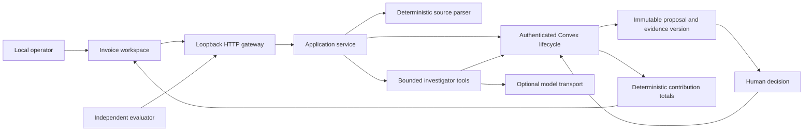

# Invoice evidence MVP architecture

The Codex worker chats used to build this software are development collaborators, unrelated to product roles. The product has one optional model role, Investigator. Human review and deterministic validation are not additional AI agents.

| Step | Implementation | Authority |
|---|---|---|
| Import originals and versions | Deterministic service + Convex | Local operator seat |
| Deduplicate and replace versions | Hashes and transactional state | Backend only |
| Parse routine layouts | Narrow rules, labeled deterministic | Backend independently validates auto-accept grammar |
| Inspect unfamiliar evidence and select next tool | Bounded optional model loop; no-model path asks for evidence | Investigator seat |
| Validate references, arithmetic and uniqueness | Ordinary code | Backend invariants |
| Accept ambiguous/model proposals | Human decision bound to proposal/evidence version | Local operator seat |
| Sum invoices minus credits | Safe integer cents | Backend only |
| Evaluate | Separate process, same HTTP boundary and persisted state | Product cannot read expected answers |

## Durable state

Immutable sources retain identity, version, text and SHA-256 of original bytes. Large originals use bounded `invoiceSourceChunks` to accommodate base64 expansion within Convex record limits. Authenticated case detail reconstructs originals. Explicit importer revisions supersede old versions transactionally; an old-version retry cannot erase newer accepted work. Duplicates remain visible with canonical references.

Cases, proposals, decisions, audit records, model reservations and contributions live in Convex. Runtime memory only manages current work. Restart resumes received/interrupted investigations; missing evidence waits for an update or operator action. New sources conservatively invalidate pending proposal versions. Accepted amounts change through explicit source replacement or a validated revision decision.

Proposals and decisions are immutable. Decisions include proposal ID, evidence version and idempotency key. Exact replay returns the original result; changed payloads, conflicting responses and stale evidence fail. Contributions are unique by current source/customer document identity. This subledger is separate from the historical simulation's general ledger and has no cash effects.

## Permissions and untrusted documents

New backend queries and mutations authenticate run-scoped seat tokens and stored role/kind. Human and investigator authority are distinct. The loopback gateway checks Host/Origin, sets an HttpOnly SameSite session cookie and requires a session header on writes. Browser code receives neither admin secret nor seat tokens. This is a local demonstration identity boundary, not production SSO.

Document text cannot change system policy, grant permissions, approve proposals or authorize external actions. Investigation tools expose source inspection, related records and policy; they do not expose shell execution, banking or arbitrary network calls. Source text is rendered as text, and original downloads do not execute document HTML.

## Models and evaluation

The default runtime makes no model calls. Injected-model tests are labeled mocks. Live requests need explicit opt-in, credentials and authorized spending. Each request reserves its conservative maximum cost atomically against immutable run caps before dispatch. A replayed reservation cannot dispatch again; a crash keeps its reservation charged. Actual usage is recorded separately. Guards and mock tests do not prove provider integration works.

The investigator can select tools and adjust its next action from returned evidence. Calculations, deduplication, permissions and accounting remain ordinary code. Model-origin conclusions need human review; evaluation distinguishes proposals, accepted outcomes and abstention.

The original benchmark imports through the application service and exports persisted totals. Its unmodified scorer is supplemented by document/evidence metrics. Held-out sources and expected outputs remained private until the first run was sealed. First-pass failures are preserved; later runs are labeled post-fix.

No independent model reviewer was added. No controlled live comparison demonstrates that another role earns its complexity. The first deterministic held-out run exposed limited interpretation of unfamiliar documents; see the evaluation report rather than inferring capability from role names.

The opt-in OpenAI transport uses the first-party Responses API with fixed `gpt-6.1-sol`, high effort and `all_turns` reasoning context. It replays native output, including opaque encrypted reasoning and call IDs, only within the current investigation; those values are not exposed in durable audit or errors. Reservations include the full serialized request plus all prior output tokens and a protocol allowance. Actual usage validates the served model, tier, cache counts and reasoning-inclusive output totals. Unusable responses retain known usage; unknown usage is never reported as zero. The existing Anthropic adapter remains the default provider when live mode is explicitly selected without a provider.

The [completed OpenAI batch](evaluation-openai-results.md) demonstrates real provider calls through the product, but not broad invoice accuracy. Product reservations remain charged at their conservative maximum after successful requests, unlike the baseline's actual-cost settlement. This exhausted the $3/$1.50 app envelopes at 29/21 calls despite lower observed costs. Changing that policy would require a separate reviewed implementation and evaluation; the measured run and its ledger are preserved.
