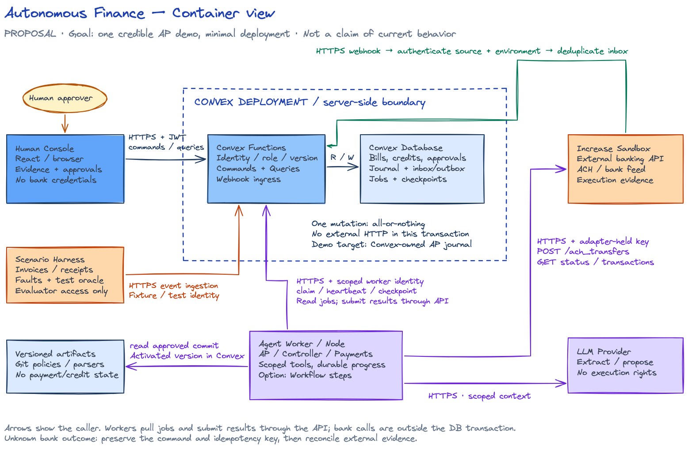
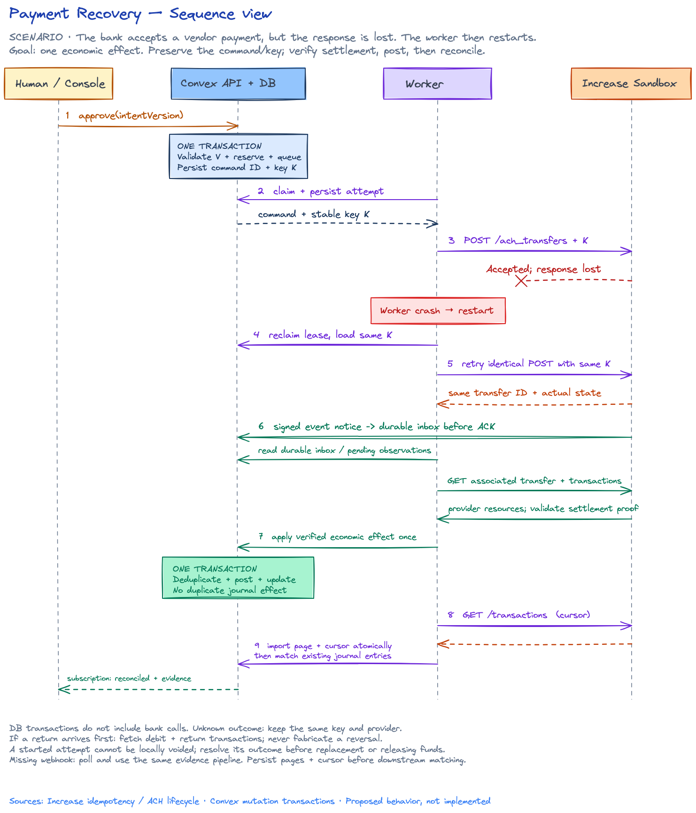
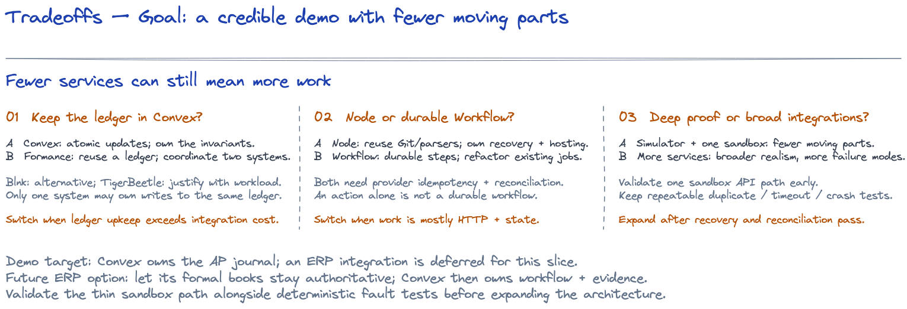
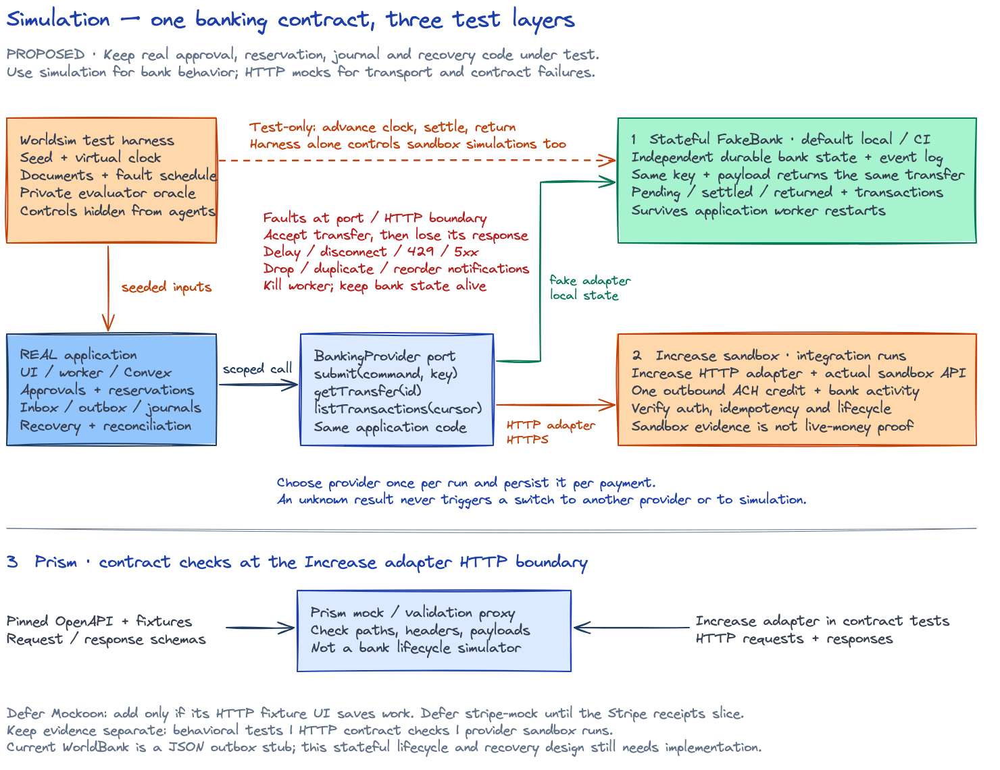
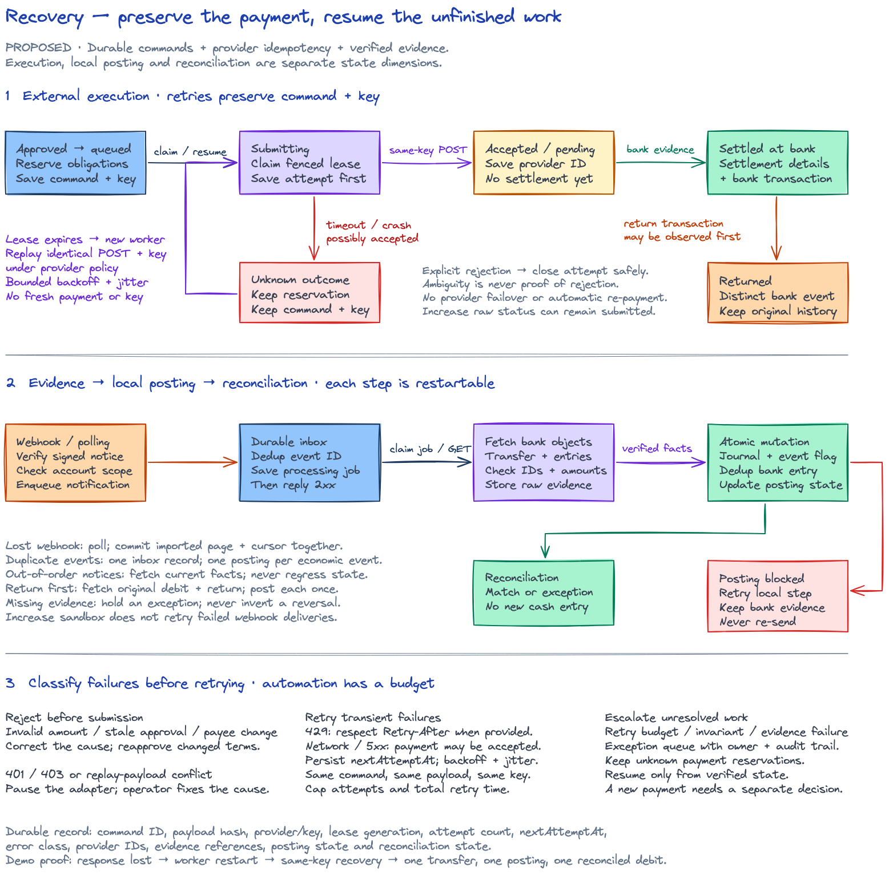
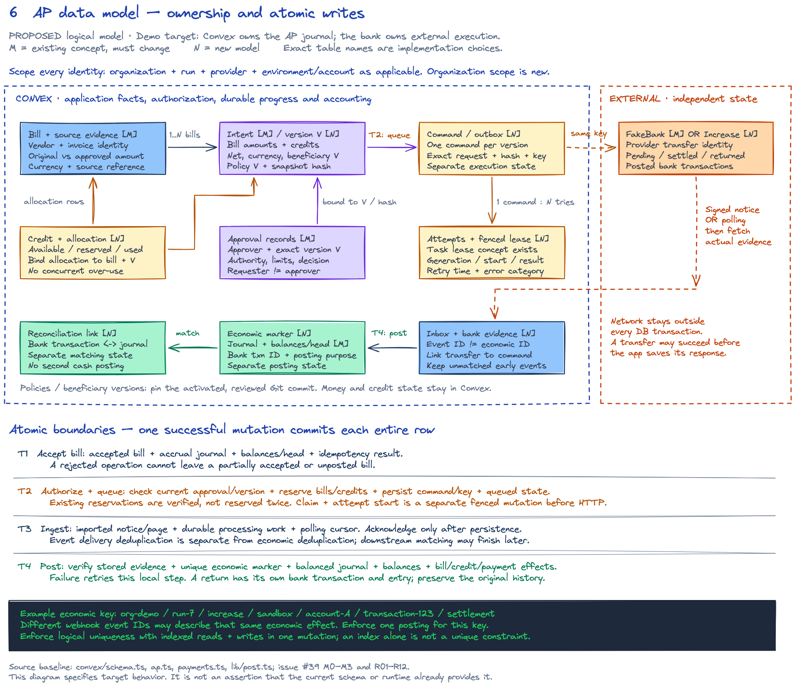
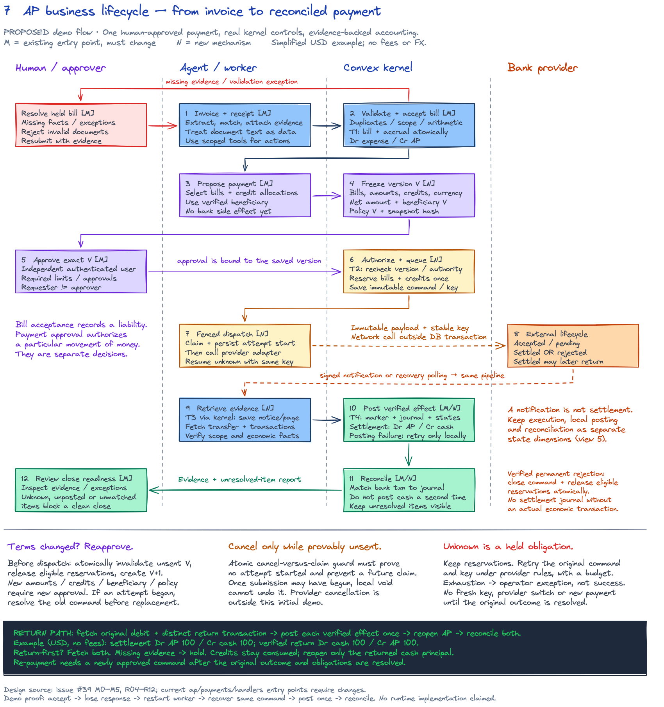

# All seven architecture diagrams

These are proposed behavior, not evidence of implemented capabilities. All seven use editable handwritten Excalidraw sources and checked-in PNG previews.

Views 6 and 7 use **M** for an existing concept that must change and **N** for a new model/mechanism. Read the [implementation contract](IMPLEMENTATION_CONTRACT.md) for exact ownership and workstream requirements.

## 1. Container and trust boundaries

Shows where the console, workers, Convex, provider and versioned artifacts run.

[Editable Excalidraw](diagrams/containers.excalidraw) · [Full-size PNG](diagrams/containers.png)

## 2. Payment recovery sequence

Shows acceptance followed by a lost response, worker restart, same-key retry, durable ingestion and evidence-backed posting.

[Editable Excalidraw](diagrams/payment-sequence.excalidraw) · [Full-size PNG](diagrams/payment-sequence.png)

## 3. Architecture tradeoffs

Records the demo target and the costs of alternate ledger, worker and integration choices.

[Editable Excalidraw](diagrams/tradeoffs.excalidraw) · [Full-size PNG](diagrams/tradeoffs.png)

## 4. Simulator and mock placement

Places Worldsim, persistent FakeBank, Increase sandbox, Prism and fault injection.

[Editable Excalidraw](diagrams/simulation.excalidraw) · [Full-size PNG](diagrams/simulation.png)

## 5. Error handling and recovery

Separates external execution, local posting and reconciliation, including exceptions and returns.

[Editable Excalidraw](diagrams/recovery.excalidraw) · [Full-size PNG](diagrams/recovery.png)

## 6. Data model and atomic boundaries

Defines logical entities, authority, identity/deduplication and T1–T4 atomic writes.

[Editable Excalidraw](diagrams/data-model.excalidraw) · [Full-size PNG](diagrams/data-model.png)

## 7. Complete AP business workflow

Shows invoice evidence, version-bound approval, guarded dispatch, settlement, rejection, return and close readiness.

[Editable Excalidraw](diagrams/business-workflow.excalidraw) · [Full-size PNG](diagrams/business-workflow.png)

