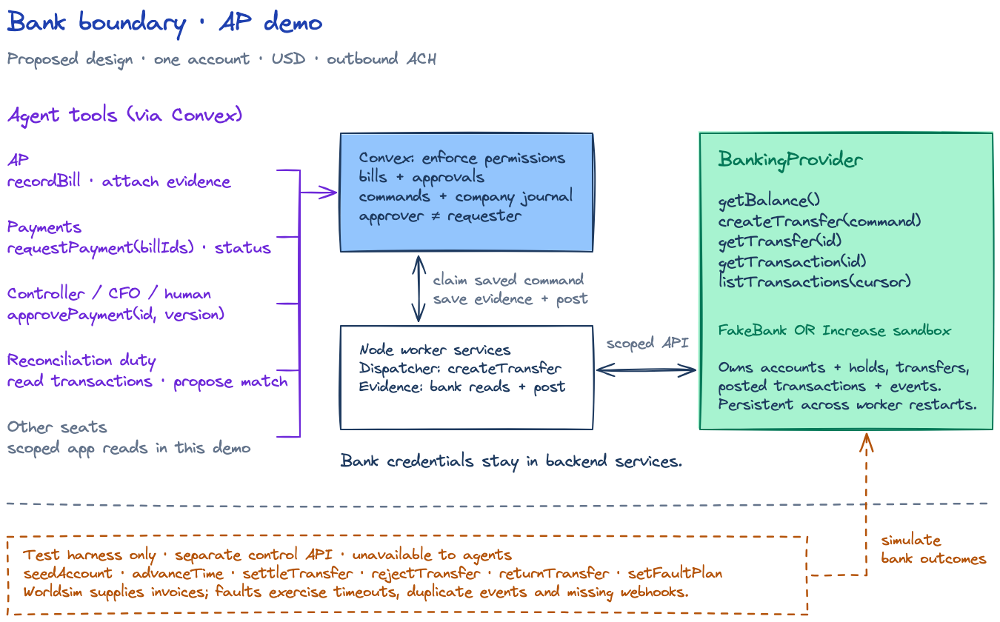
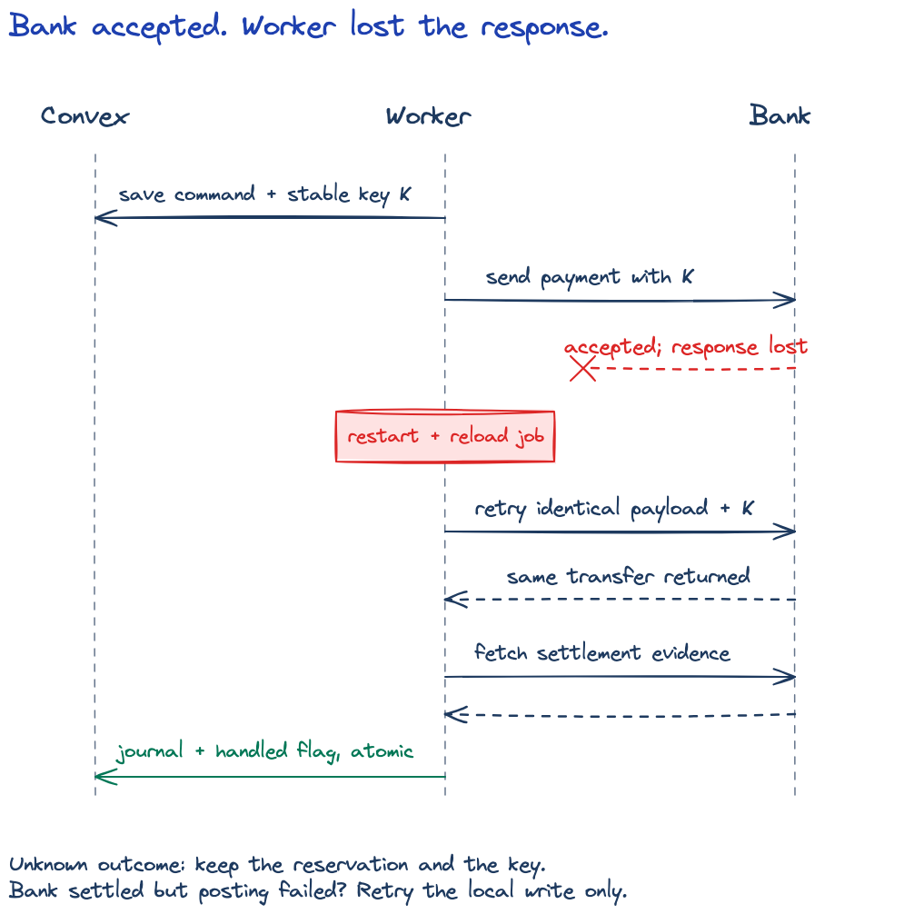

# AP demo

One invoice, one USD account, outbound ACH. Approval → payment → reconciliation must survive a worker restart without paying twice.

Keep Convex + the Node worker. Worldsim supplies invoices; persistent FakeBank tests failures; Increase sandbox verifies the real API.

[Edit drawing](diagrams/system.excalidraw)

## Bank contract

`getBalance()` · `createTransfer(command)` · `getTransfer(id)` · `getTransaction(id)` · `listTransactions(cursor)`

Bank owns **balances/holds, transfers, posted transactions and events**. Convex owns **bills, approvals, commands and the company journal**.

The backend binds the client to organization/run/environment/account and checks ID ownership. Commands freeze ID, integer cents, USD, destination and idempotency key. Same key/payload returns the same transfer; changed payload fails. Acceptance is not settlement.

| Caller | Access in this demo |
| --- | --- |
| AP | Record bills, attach evidence, flag discrepancies |
| Payments | `requestPayment(billIds)`, `getPaymentStatus(id)` |
| Controller / CFO / human | `approvePayment(id, version)` within policy; never own request |
| Reconciliation duty (controller) | Read imported transactions; propose matches/exceptions |
| Other agent seats | Scoped demo views; no bank calls |
| Dispatcher / evidence service | Submit approved commands / read bank evidence and post once |

Backend enforcement, not prompt instructions. Compute amounts/destinations from approved records. Require human approval for the demo. Agents get no bank credentials, arbitrary cash posting or test controls.

**Harness only:** `seedAccount`, `advanceTime`, `settleTransfer`, `rejectTransfer`, `returnTransfer`, `setFaultPlan` through a separate test-only API. Prism is optional contract testing; defer ERP/external ledgers.

## Build

- [ ] **A — FakeBank.** Shared interface; durable bank state; atomic updates; idempotency conflicts; accept-then-drop-response fault.
- [ ] **B — Dispatch.** Fix approval/credit handling. Atomically reserve and save commands. Resume after crashes, reject stale workers, prevent cancellation/send races. Keep reservations for unknown outcomes.
- [ ] **C — Reconcile.** Verified webhooks + polling. Deduplicate evidence; post once. Retry local writes without resending. Record returns separately; surface unresolved payments.
- [ ] **D — Increase.** Same interface, adapter contract tests, reproducible sandbox demo with bank transaction + journal evidence.

Agree the interface, then A/B can run together. C consumes their saved IDs; D validates the full flow.

[Edit drawing](diagrams/recovery-flow.excalidraw)

## Done when

1. One approved invoice → one bank debit → one matching journal entry.
2. Lost response + restart + missing webhook recover the same payment. Duplicate events, returns and local-write failures preserve correct balances.
3. Changed details need fresh approval. Unauthorized roles, cross-account/run IDs and agent test-control access fail. Unresolved outcomes block a clean close.

Track ownership in [issue #39](https://github.com/srivatsav-kannan/autonomous-finance/issues/39).

[Detailed checks](TODO.md) · [Reference drawings](DIAGRAMS.md)

Proposed design; runtime implementation is still outstanding.
